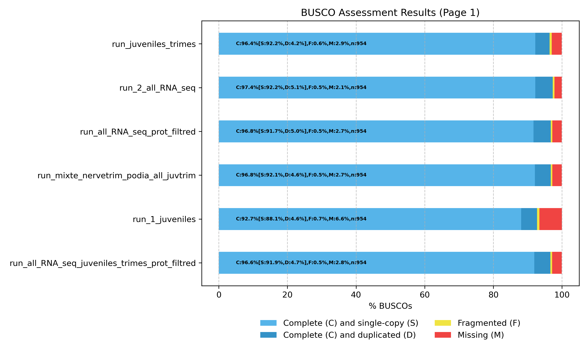

# Cahier de laboratoire

Ce cahier retrace les différentes étapes du projet. Il contient les tâches réalisées par chaque membre du groupe, les données utilisées et leur localisation, les outils et leurs versions, ainsi que les commandes et scripts exécutés.


Etape 1 : récupération des données de référence

•	Identifier l'accès au génome : Trouver la bonne référence officielle d'Acanthaster planci sur le NCBI.

•	Télécharger les fichiers indispensables : Récupérer d'un côté la séquence du génome (FASTA) et de l'autre l'annotation de référence (GFF3).

•	Organiser et nettoyer l'espace de travail : Ranger ces fichiers dans un dossier dédié sur le serveur et configurer le .gitignore pour éviter de les envoyer par erreur sur GitHub. Masquer les dossiers cachés (ceux qui commencent par un point comme .ssh ou .cache) avec Files: Exclude (**/.*).

•	Création et activation de l'environnement personnel pour contourner les restrictions d'écriture globales avec conda activate .

•	Installation de l'outil datasets dans env_sa avec conda install -c conda-forge ncbi-datasets-cli et téléchargement du génome de référence GCF_054643075.1 avec datasets download genome accession GCF_054643075.1 --include genome, puis décompression avec unzip ncbi_dataset.zip.


Etape 2 :  Lancement et configuration d'EviAnn

•   Tentative 1 : Lancement d’EviAnn dans une session screen, avec le génome, les protéines homologues et les données RNA-seq, en utilisant 8 cœurs.
Enregistrement du calcul : Les traces d’exécution sont enregistrées dans eviann.log.
--> Échec du lancement : Le calcul s’est arrêté lors de l’alignement avec Miniprot en raison d’un manque de mémoire RAM.

•   Tentative 2 :  Nouveau lancement, mais blocage pour la meme raison .

•   Partitionnement du génome : Division du génome en deux parties à l’aide de Seqkit, puis annotation séparée de chaque partie avec EviAnn afin de réduire la consommation mémoire.

•   Les deux annotations obtenues sont ensuite réunies pour reconstituer l’annotation complète du génome.

---

01/10 

Deux exécutions d’EviAnn ont été réalisées sur les partitions genomic_part_001 et genomic_part_002, permettant d'obtenir pour chacune un fichier GFF3 d’annotation et un fichier FASTA de protéines prédites. Les deux GFF3 ont été fusionnés en conservant un seul en-tête à l’aide de head et tail :

{
  head -3 part_001.gff
  tail -n +4 part_001.gff
  tail -n +4 part_002.gff
} > A_planci.gff

Les fichiers protéiques ne possédant pas d’en-tête commune, ils ont simplement été concaténés avec cat :
cat part_001.proteins.fasta part_002.proteins.fasta > A_planci.proteins.fasta

Les fichiers finaux A_planci.gff (~88 Mo) et A_planci.proteins.fasta (~24 Mo) sont stockés dans /data/projet3/annotation_complete/. Les fichiers originaux des deux partitions ont été conservés.

---
02/10
Évaluation de l’annotation EviAnn par comparaison avec le génome de référence

Afin d’évaluer l’annotation produite par EviAnn, l’annotation génomique de référence correspondant au même assemblage a également été récupérée à l’aide de NCBI Datasets dans l’environnement Conda env_sa.

Le fichier d’annotation de référence genomic.gff a été extrait puis renommé en genome_ref.gff. Il a été placé dans /data/projet3/annotation_complete/, avec le fichier d’annotation EviAnn A_planci.gff et le fichier de protéines prédites A_planci.proteins.fasta.

L’outil gffcompare 0.12.10 a ensuite été installé dans l’environnement partagé env_sa. Les permissions de cet environnement ont été configurées afin que les membres du groupe projet3 puissent utiliser les outils qui y sont installés, sans pouvoir les modifier.

Les fichiers nécessaires à l’évaluation sont ainsi regroupés dans /data/projet3/annotation_complete/ :
A_planci.gff (proteine_annotation_file.gff)
A_planci.proteins.fasta (proteins_sequences_file.fasta)
genome_ref.gff(ref_annotation.gff)


### Comparaison de l’annotation EviAnn avec l’annotation de référence

Afin d’évaluer la qualité de l’annotation produite par EviAnn, une annotation de référence correspondant au même assemblage génomique (*Acanthaster planci*, `GCF_054643075.1`) a été récupérée à l’aide de **NCBI Datasets**.

Le fichier d’annotation de référence a été placé dans :

```text
/data/projet3/acanthaster_planci_datas/annotation/ref_annotation.gff
```

L’annotation produite par EviAnn correspond au fichier :

```text
/data/projet3/eviann_annotations/eviann_split_genome_1/proteine_annotation_file.gff
```

L’outil **gffcompare 0.12.10** a été utilisé pour comparer l’annotation EviAnn à l’annotation de référence. Un problème de permissions empêchait initialement la création des fichiers de sortie dans le dossier contenant l’annotation EviAnn. Le fichier d’annotation a donc été copié dans un dossier de travail accessible, puis la comparaison a été réalisée à partir de cette copie.

Les résultats de la comparaison ont ensuite été placés dans :

```text
/data/projet3/eviann_annotations/gffcompare_result/
```

Les principaux résultats obtenus sont :

* **34 395** transcrits EviAnn contre **47 324** transcrits de référence.
* Sensibilité au niveau des transcrits : **43,4 %**.
* Précision au niveau des transcrits : **59,7 %**.
* Sensibilité au niveau des introns : **77,4 %**.
* Précision au niveau des introns : **96,6 %**.
* **20 535** transcrits présentent une correspondance avec la référence.
* **13 755** loci présentent une correspondance avec la référence.
* **700 loci** sont considérés comme nouveaux par rapport à la référence.

Ces résultats indiquent que l’annotation EviAnn présente une **bonne précision**, notamment au niveau des introns, mais une **sensibilité plus modérée**, en particulier au niveau des transcrits. Une partie des transcrits présents dans l’annotation de référence n’est donc pas retrouvée par EviAnn.

### Mise à disposition de GFFCompare

L’outil **GFFCompare 0.12.10** a été installé dans l’environnement Conda partagé :

```text
/data/projet3/conda/env_sa
```

Les permissions de cet environnement ont été modifiées afin que les membres du groupe `projet3` puissent **lire, modifier et ajouter des logiciels** dans cet environnement partagé.

Pour l’activer :

```bash
conda activate /data/projet3/conda/env_sa
```

Ainsi, les membres du projet peuvent utiliser GFFCompare et installer d’autres outils nécessaires dans le même environnement.

---

# **Étudiant :** Shahiran Kuganaathan  
**Projet :** Annotation du génome d'*Acanthaster planci*  
**Génome utilisé :** `GCF_054643075.1_COTS_SCS` (2026)


## 20/09/2026 — Préparation des environnements Conda

Au début du projet, un dossier contenant des environnements Conda était déjà disponible. Cependant, je n'avais pas les permissions nécessaires pour y créer de nouveaux environnements ou installer d'autres logiciels.

J'ai donc créé temporairement mes propres répertoires pour pouvoir avancer, notamment sur le téléchargement des protéines homologues nécessaires à l'annotation.

### Création des répertoires

```bash
mkdir conda_temporaire
mkdir conda_environment_exports/
```

Le dossier `conda_temporaire` servait à installer les environnements dont j'avais besoin. J'ai également créé `conda_environment_exports` pour conserver les fichiers YAML décrivant les environnements et leurs dépendances, afin de pouvoir les recréer si nécessaire.

Les dossiers ont ensuite été réorganisés par Yassine : `conda_temporaire` a été renommé en `conda_environments`, et les exports se trouvent maintenant dans `conda_environments/conda_env_exports/`.

### Création de l'environnement pour Entrez Direct

Pour récupérer les protéines homologues depuis NCBI, j'ai utilisé Entrez Direct. Cet outil permet de rechercher et de télécharger des séquences directement depuis le terminal, sans avoir à les récupérer une par une sur le site de NCBI.

J'ai créé un environnement Conda pour installer l'outil :

```bash
conda create -p /data/projet3/conda_temporaire/env_ncbi
conda activate /data/projet3/conda_temporaire/env_ncbi
conda install -c bioconda entrez-direct
```

J'ai ensuite vérifié que les commandes étaient accessibles :

```bash
which esearch
which efetch
```

`esearch` sert à rechercher des entrées dans les bases NCBI, tandis que `efetch` permet de récupérer les séquences dans le format souhaité, ici en FASTA.

**Version d'Entrez Direct :** 26.0.

### Création du cahier de laboratoire et gestion des permissions

J'ai créé le fichier du cahier de laboratoire :

```bash
touch cahier_de_labo.md
```

J'ai également modifié les permissions de plusieurs fichiers et dossiers utilisés dans le projet :

```bash
chmod 775 cahier_de_labo.md
chmod 775 conda_environment_exports/
chmod 775 homology_data_test/
chmod 775 conda_temporaire/
```

---

## 20/09/2026 — Recherche et téléchargement des protéines homologues

Avant le téléchargement, j'ai consulté le README d'EviAnn pour connaître les recommandations concernant les protéines homologues utilisées pour l'annotation.

La documentation conseille de fournir des protéines provenant de plusieurs espèces apparentées, avec idéalement **5 à 10 fois plus de séquences que le nombre de protéines attendu** chez l'espèce étudiée.

**Documentation :** https://github.com/alekseyzimin/EviAnn_release/blob/main/README.md

Pour *Acanthaster planci*, l'annotation NCBI du génome `GCF_054643075.1` (2026) indique **18 608 gènes codant des protéines**. J'ai donc pris comme ordre de grandeur un ensemble d'environ **93 040 à 186 080 séquences protéiques homologues**.

J'ai choisi la classe **Asteroidea**, qui regroupe les étoiles de mer, dont *Acanthaster planci*, afin de récupérer des protéines d'organismes proches. Son identifiant taxonomique NCBI est `7588`.

### Téléchargement des protéines

J'ai créé un dossier pour le téléchargement :

```bash
mkdir homology_data_test
```

J'ai ensuite ouvert une session Screen pour laisser le téléchargement se poursuivre sur le serveur en cas de déconnexion SSH :

```bash
screen -S download_proteins
```

Dans cette session, j'ai utilisé la commande suivante :

```bash
esearch -db protein -query "txid7588[Organism:exp]" | efetch -format fasta > asteroidea_proteins.faa
```

La requête récupère les séquences protéiques associées à la classe Asteroidea, sous-groupes inclus, et les enregistre au format FASTA.

### Vérification du téléchargement

Après le téléchargement, j'ai vérifié la présence et la taille du fichier :

```bash
ls -lh /data/projet3/homology_data_test/asteroidea_proteins.faa
```

J'ai ensuite compté les entrées FASTA, identifiées par les lignes commençant par `>` :

```bash
grep -c '^>' /data/projet3/data_sets/homology_data_set/asteroidea_proteins.faa
```

**Résultat :** 139 392 séquences protéiques, pour un fichier d'environ 104 Mo.

Cela correspond à environ 7,5 fois les 18 608 gènes codants de l'annotation de référence, ce qui se situe dans la fourchette recommandée par EviAnn.

Après réorganisation des dossiers, le fichier est conservé ici :

`/data/projet3/data_sets/homology_data_set/asteroidea_proteins.faa`

---

## 29/09/2026 – 30/09/2026 — Recherche et téléchargement de données RNA-seq supplémentaires

### Choix des données RNA-seq

Pour l'annotation, nous avions besoin de données RNA-seq provenant de **plusieurs tissus et stades de développement**. Tous les gènes ne sont pas exprimés dans les mêmes tissus ni au même moment : utiliser différents échantillons permet donc d'obtenir des informations sur davantage de transcrits.

Deux échantillons juvéniles étaient déjà disponibles dans le projet. J'ai recherché sur NCBI SRA des données provenant d'autres tissus pour les compléter.

J'ai retenu les accessions suivantes :

- **Gonad :** `SRR37114952`
- **Spine :** `SRR37114948`
- **Stomach :** `SRR37114954`

### Téléchargement des données

Pour récupérer les données RNA-seq depuis NCBI, j'ai utilisé SRA Toolkit, notamment `prefetch`, qui permet de télécharger les fichiers associés aux accessions SRA.

J'ai lancé les téléchargements dans une session Screen :

```bash
screen -S download_rnaseq
```

**Commandes de téléchargement :**

```bash
prefetch SRR37114952 -O /data/projet3/data_sets/RNAseq_data_test/sra_downloads

prefetch SRR37114948 -O /data/projet3/data_sets/RNAseq_data_test/sra_downloads

prefetch SRR37114954 -O /data/projet3/data_sets/RNAseq_data_test/sra_downloads
```

Ces commandes correspondent respectivement aux échantillons Gonad, Spine et Stomach. L'option `-O` permet de préciser le chemin de sortie.

---

## 29/09/2026 – 30/09/2026 — Conversion des fichiers SRA en FASTQ

**Outil :** SRA Toolkit 3.4.1  
**Script :** `/data/projet3/data_sets/RNAseq_data_set/convert_rnaseq.sh`

Après le téléchargement, j'ai converti les trois échantillons SRA au format FASTQ pour pouvoir utiliser les lectures dans les analyses suivantes.

J'ai écrit le script Bash `convert_rnaseq.sh` pour conserver les commandes et effectuer les conversions des trois échantillons.

### Script utilisé

```bash
#!/bin/bash

set -e

BASE="/data/projet3/data_sets/RNAseq_data_test"
TMP="$BASE/sra_tmp"

echo "Conversion gonad..."
fasterq-dump "$BASE/sra_downloads/SRR37114952/SRR37114952.sra" --split-files -e 2 -t "$TMP" -O "$BASE/gonad_dataset"

echo "Conversion spine..."
fasterq-dump "$BASE/sra_downloads/SRR37114948/SRR37114948.sra" --split-files -e 2 -t "$TMP" -O "$BASE/spine_dataset"

echo "Conversion stomach..."
fasterq-dump "$BASE/sra_downloads/SRR37114954/SRR37114954.sra" --split-files -e 2 -t "$TMP" -O "$BASE/stomach_dataset"
```

L'option `--split-files` permet d'obtenir les deux fichiers de lectures appariées (`_1.fastq` et `_2.fastq`). J'ai utilisé deux threads (`-e 2`), un dossier temporaire défini avec `-t` et un dossier de sortie défini avec `-O`. La commande `set -e` arrête le script en cas d'erreur.

À la fin du script, j'ai ajouté les commandes suivantes pour supprimer les fichiers SRA téléchargés et le dossier temporaire une fois les conversions terminées :

```bash
rm -rf "$BASE/sra_downloads/SRR37114952"
rm -rf "$BASE/sra_downloads/SRR37114948"
rm -rf "$BASE/sra_downloads/SRR37114954"
rm -rf "$TMP"
```

---

## 29/09/2026 — Installation de FastQC et contrôle qualité des données juvéniles

**Outil :** FastQC 0.12.1

J'ai utilisé FastQC pour contrôler la qualité des données RNA-seq avant leur utilisation dans l'annotation. J'ai créé un environnement Conda dédié afin d'installer le logiciel sans modifier les autres environnements du projet.

### Création de l'environnement FastQC

```bash
conda create -p /data/projet3/conda_temporaire/env_fastqc -c conda-forge -c bioconda fastqc
conda activate /data/projet3/conda_temporaire/env_fastqc
fastqc --version
```

Après réorganisation des dossiers, l'environnement se trouve dans :

`/data/projet3/conda_environments/env_fastqc`

### Contrôle qualité des échantillons juvéniles

J'ai lancé FastQC avec quatre threads sur les deux échantillons juvéniles déjà disponibles dans le projet :

```bash
fastqc -t 4 -o /data/projet3/fastqc_results \
/data/projet3/data_sets/RNAseq_data_test/SRR37199246_dataset/SRR37199246_1.fastq \
/data/projet3/data_sets/RNAseq_data_test/SRR37199246_dataset/SRR37199246_2.fastq \
/data/projet3/data_sets/RNAseq_data_test/SRR37199247_dataset/SRR37199247_1.fastq \
/data/projet3/data_sets/RNAseq_data_test/SRR37199247_dataset/SRR37199247_2.fastq
```

Les résultats ont été enregistrés dans `fastqc_results`. J'ai créé deux dossiers pour séparer les rapports :

```bash
mkdir -p Juvenile_Replicat1 Juvenile_Replicat2
mv SRR37199247_* Juvenile_Replicat1/
mv SRR37199246_* Juvenile_Replicat2/
```

Les rapports HTML et ZIP ont été générés pour les quatre fichiers FASTQ.

### Consultation des rapports

J'ai consulté les rapports FastQC pour repérer d'éventuels problèmes de qualité. Dans les deux échantillons juvéniles, `Adapter Content` présente un statut **FAIL**, avec une augmentation des adaptateurs Illumina vers la fin des lectures.

Ces résultats m'ont amené à envisager un **trimming des adaptateurs**, puis une nouvelle annotation avec EviAnn pour comparer les résultats obtenus avec des lectures nettoyées et non nettoyées.

---

## 08/10/2026 — Contrôle qualité des autres échantillons RNA-seq

**Outil :** FastQC 0.12.1  
**Script :** `/data/projet3/fastqc_results/run_fastqc.sh`

J'ai ensuite lancé FastQC sur les trois échantillons supplémentaires : Gonad, Stomach et Spine. J'ai écrit un script Bash pour garder les commandes utilisées et lancer les contrôles qualité par tissu.

### Script utilisé

```bash
#!/bin/bash

DATA="/data/projet3/data_sets/RNAseq_data_set"
OUT="/data/projet3/fastqc_results"

echo "Début FastQC Gonad"
fastqc -t 4 -o "$OUT/Gonad" "$DATA"/gonad_dataset/*.fastq

echo "Début FastQC Stomach"
fastqc -t 4 -o "$OUT/Stomach" "$DATA"/stomach_dataset/*.fastq

echo "Début FastQC Spine"
fastqc -t 4 -o "$OUT/Spine" "$DATA"/spine_dataset/*.fastq
```

Pour chaque tissu, FastQC utilise quatre threads (`-t 4`). Les rapports sont enregistrés dans des sous-dossiers distincts de `fastqc_results`.

---

## 10/10/2026 — Lancement d'EviAnn sur la deuxième partie du génome

J'ai lancé EviAnn sur la deuxième partie du génome d'*Acanthaster planci* (`part_002`), avec les données RNA-seq des cinq échantillons disponibles : Gonad, Spine, Stomach et les deux échantillons juvéniles.

J'ai également utilisé le fichier de **139 392 séquences protéiques homologues** des Asteroidea téléchargé précédemment.

### Commande utilisée

```bash
eviann.sh -t 2 \
-g /data/projet3/acanthaster_planci_ref_datas/genome/split_genome/GCF_054643075.1_COTS_SCS_genomic.part_002.fna \
-r /data/projet3/data_sets/RNAseq_data_set/rnaseq_list.txt \
-p /data/projet3/data_sets/homology_data_set/asteroidea_proteins.faa \
--verbose > eviann_run2_part002.log 2>&1
```

Options utilisées :

- `-t 2` : utilise deux threads.
- `-g` : indique le fichier FASTA de la deuxième partie du génome.
- `-r` : indique le fichier contenant la liste des données RNA-seq.
- `-p` : indique le fichier FASTA des protéines homologues.
- `--verbose` : affiche les messages détaillés du programme.
- `> eviann_run2_part002.log 2>&1` : enregistre la sortie standard et les messages d'erreur dans un fichier log.

---

## Suite envisagée

À partir des résultats FastQC des échantillons juvéniles, je souhaite tester un trimming des adaptateurs. L'objectif est ensuite de relancer EviAnn avec les lectures nettoyées et de comparer les résultats avec ceux de l'analyse réalisée sans trimming.

**Cette étape n'a pas encore été réalisée.**

---

# **Étudiant :** Ouahbi Yassine

**Membres du groupe :** Yassine OAUHBI, Shahiran KUGANAATHAN, Sarah AMZALLAG

**Espace de travail (Serveur) :** `/data/projet3/`

**Dépôt distant (GitHub) :** `https://github.com/yassineouahbi04-design/PTU_MASTER_projet3`

## Organisation de l'espace de travail et reproductibilité

  L'arborescence du projet a été restructurée le 07/10/2026 pour garantir une séparation stricte des données, des environnements et des résultats. À la racine du projet, nous retrouvons les fichiers de documentation au format Markdown (`README.md`, `cahier_de_labo.md`, `rapport.md`) ainsi que le fichier `.gitignore`. 

  Les données et exécutions sont organisées dans les dossiers principaux suivants :

  * **`acanthaster_planci_ref_datas/` :** centralise l'annotation officielle (`annotation/`) et le génome de référence (`genome/`).

  * **`data_sets/` :** isole les données d'évidences biologiques. Il est scindé en :

    * `homology_data_set/` : contient la base protéique.
    * `RNAseq_data_set/` : contient les sous-dossiers classés par tissu (`gonad_dataset/`, `spine_dataset/`, `stomach_dataset/`), les données de test (`juvenile_data_set/`), l'espace de transit (`sra_downloads/`), le script d'extraction (`convert_rnaseq.sh`) et le fichier manifeste (`rnaseq_list.txt`).

  * **`annotation_datas/` :** ce répertoire maître regroupe toute l'activité et l'évaluation du pipeline. Il est subdivisé en :

    * `eviann_datas/` : contient l'historique des exécutions (`eviann_runs/`) et les fichiers finaux fusionnées (`eviann_results/`).

    * `gff_compare_results/` : contient les évaluations de l'annotation générée face à l'annotation officielle pour chaque run. 

  * **`fastqc_results/` :** répertoire dédié aux rapports de contrôle qualité des lectures, organisé par tissu.

  La reproductibilité est assurée par le répertoire `conda_environments`. Il contient les environnements virtuels, crés par Shahiran, isolant les dépendances logicielles : 
  
  * `env_ncbi` (`fasterq-dump` v3.4.1)
  * `env_fastqc` (`fastqc` v0.12.1)
  * `env_seqkit` (`seqkit` v2.14.0)
  * `env_eviann` (EviAnn v2.0.6)
  * `env_gff_compare` (`gffcompare` v0.12.10).
  
  Les fichiers de configuration exacts sont sauvegardés dans le sous-dossier `conda_env_exports`.

## Journal des sessions de travail

  **24/09/2026 — Acquisition du génome de référence**

  J'ai initialisé le projet en téléchargeant l'assemblage de référence d'*Acanthaster planci* depuis le NCBI, puis l'ai décompressé.
  ```bash
  mkdir -p /data/projet3/acanthaster_planci_ref_datas/genome/entier_genome/
  
  cd /data/projet3/acanthaster_planci_ref_datas/genome/entier_genome/

  wget "[https://ftp.ncbi.nlm.nih.gov/genomes/all/GCF/054/643/075/GCF_054643075.1_COTS_SCS/GCF_054643075.1_COTS_SCS_genomic.fna.gz]"

  gunzip -k GCF_054643075.1_COTS_SCS_genomic.fna.gz
  ```

**26/09/2026 — Extraction des données test RNA-seq**

  J'ai extrait les données transcriptomiques de test en paires FASTQ avec l'outil `fasterq-dump` depuis l'environnement `env_ncbi`. 

  Le choix de ces données s'est porté sur ce set pour des raisons purement techniques (test de faisabilité du pipeline et calibrage de l'empreinte mémoire), sans aucune logique biologique sous-jacente. 
  
  Les séquences brutes proviennent du projet NCBI d'accession `PRJNA1422445`, issu d'une étude portant sur le mécanisme d'influence des algues calcifiées sur la croissance et le développement des juvéniles d'étoiles de mer (réalisée par le South China Sea Institute of Oceanology). Cette dernière presente douze runs. Deux d'entre eux (`SRR37199246` et `SRR37199247`) on été choisit sur la base leurs taile (en paire de base), respectivement `8.48 G` et `8.29 G` (les plus élevés).   
  
  L'option `-t .` a été utilisée pour forcer l'écriture des fichiers temporaires dans le répertoire de projet, évitant la saturation de l'espace personnel.

  ```bash 

  conda conda_environments/env_ncbi

  cd data_sets/RNAseq_data_set/juvenile_data_set/

  fasterq-dump -t . --split-files SRR37199246
  fasterq-dump -t . --split-files SRR37199247
  ```

  Les données ont ensuites étaient répartie en 2 fichier, `juvenille_resplicat_1` (qui regoupe les données `SRR37199247`) et `juvenille_replicat_2` (qui regroupe les données `SRR37199246`) 
  
**27/09/2026 — Test EviAnn**
  
  Un premier test du pipeline EviAnn a été initié sur l'assemblage complet du génome au sein d'une session `screen` allouant 8 cœurs. Un fichier `rnaseq_list.txt` a été crée, regroupant les chemins des lectures de test `juvenile_data_set`, avec la mention fastq en fin de ligne, pour satisfaire le parser d'EviAnn.    

  ```bash

  # Création du fichier rnaseq_list.txt
  ls /data/projet3/data_sets/RNAseq_data_set/juvenile_data_set/*.fastq > /data/projet3/data_sets/RNAseq_data_set/rnaseq_list.txt

  # Lancement du pipeline EviAnn
  screen -S eviann_test_1
  
  conda conda_environments/env_eviann

  cd annotation_datas/eviann_datas/eviann_runs/test_1_run
  
  eviann.sh
  -g /data/projet3/acanthaster_planci_ref_datas/genome/entier_genome/GCF_054643075.1_COTS_SCS_genomic.fna
  -p /data/projet3/data_sets/homology_data_set/asteroidea_proteins.faa 
  -r /data/projet3/data_sets/RNAseq_data_set/rnaseq_list.txt
  -t 8 2>&1 | tee eviann.log
  ``` 
  
  Le processus (tracé dans `test_1_run`) a été brutalement interrompu par le système (`Killed`) lors de l'étape d'alignement avec miniprot. Une seconde tentative sans multithreading (tracée dans `test_2_run`) a également échoué. 
  
  Le diagnostic a révélé que l'empreinte mémoire du génome complet saturait la RAM du serveur (déclenchement de l'OOM Killer).

**28/09/2026 — Solution au problème EviAnn (run_1)**
  
  Après l’interruption des essais sur le génome entier faute de mémoire, j'ai réparti le génome en deux fichiers avec SeqKit :

  ```bash
  # On activte l'environnement seqkit
  
  conda activate conda_environments/env_seqkit/
  
  # On lance la commande pour fragmenter le génome en deux, dans un nouveau dossier

  seqkit split2 -p 2 GCF_054643075.1_COTS_SCS_genomic.fna -O split_genome/
  ```

  À l'aide de cet outil, le génome de référence a été scindé en deux sous-ensembles équilibrés en volume de paires de bases sans rompre aucun scaffold.

  EviAnn a ensuite été lancé séparément sur chaque partie. Les deux exécutions et leurs résultats sont rangés dans `annotation_datas/eviann_datas/eviann_runs/run_1/`, sous `genomic_part_001/` et `genomic_part_002/`.

  Les extraits des journaux EviAnn indiquent qu’un fichier d’annotation GFF a été produit pour chaque partie :

  | Résultat indiqué par EviAnn | Partie 001 | Partie 002 | Somme |
  |---|---:|---:|---:|
  | Genes | 9 559 | 9 013 | 18 572 |
  | Protein coding genes | 9 076 | 8 578 | 17 654 |
  | Processed pseudo gene transcripts | 34 | 31 | 65 |
  | Processed pseudo genes | 34 | 31 | 65 |
  | Transcripts | 17 137 | 16 395 | 33 532 |
  | Long non-coding RNAs | 456 | 407 | 863 |
  | Distinct proteins | 14 713 | 13 908 | 28 621 |

  La colonne « Somme » additionne les compteurs des deux exécutions. Les annotations GFF ont pas la suite été réunies et comparées à l’annotation de référence. On remarque néanmoins que la somme des protéines distinctes dénombrées dans chaque partie ne prouve pas qu’il existe 	22 342 protéines distinctes à l’échelle du génome complet, comme indiqué pour la référence.

**08/10/2026 — Lancement du run 2 avec l’ensemble des données RNA-seq téléchargées**

  J'ai relancé EviAnn dans `annotation_datas/eviann_datas/eviann_runs/run_2/genomic_part_001/`, sur la première partie du génome, en allouant 4 cœurs cette fois-ci et en utilisant toutes les données RNA-seq à disposition.   
  
  ```bash 
  # EviAnn a été lancer avec la commande suivante

  eviann.sh  
  -g /data/projet3 /acanthaster_planci_ref_datas/genome/split_genome/GCF_054643075.1_COTS_SCS_genomic.part_001.fna  
  -p /data/projet3/data_sets/homology_data_set/asteroidea_proteins.faa  
  -r /data/projet3/data_sets/RNAseq_data_set/rnaseq_list.txt -t 4 2>&1 | tee eviann.log
  ```
  
  L’option `-r` désigne le fichier `rnaseq_list.txt`, qui regroupe les chemins des paires de fichiers RNA-seq utilisées pour cette exécution, comme expliquer précedement .

  Une première erreur provenait du chemin donné à `-r` : la commande indiquait `RNAseq_data_test` au lieu de `RNAseq_data_set`. Après cette correction, EviAnn a pu lire le manifeste et construire l’index HISAT2, mais l’alignement s’est arrêté avec le message suivant :

  ```text
  [main_samview] fail to read the header from "/dev/stdin".
  Alignment with HISAT2 or transcript assembly with StringTie failed
  ```

  La vérification des chemins à l’intérieur de `rnaseq_list.txt` a ensuite mis en évidence que certains fichiers FASTQ n’étaient pas désignés par le bon chemin. La recherche peut être reproduite avec cette commande, qui affiche le numéro de ligne et le chemin de chaque fichier absent ou vide :

  ```bash
  liste=/data/projet3/data_sets/RNAseq_data_set/rnaseq_list.txt

  awk 'NF >= 2 {print NR, $1; print NR, $2}' "$liste" |
  while read -r numero fichier; do
    [ -s "$fichier" ] ||
        printf 'Ligne %s — fichier absent ou vide : %s\n' "$numero" "$fichier"
  done
  ```

  Les chemins erronés du manifeste ont été corrigés, puis EviAnn a été relancé.

**09/10/2026 — Diagnostic de l’échec du run 2**

  Le journal `eviann.log` indique que miniprot s’est une nouvelle fois arrêté avec le message `Killed` pendant l’alignement des protéines. Les fichiers intermédiaires nécessaires aux étapes suivantes n’ont pas été produits. Le GFF annoncé en fin d’exécution contient 0 gène et n’est pas exploitable.

  Afin de mieux comprendre le problème avec miniprot, ce dernier à été lancé seul sur le meme set de données (RNA-seq et homologie).
  Après avoir activé l’environnement `env_eviann`, nous avons relancé le test avec un seul cœur pour mesurer la mémoire utilisée par miniprot indépendamment d’EviAnn :

  ```bash
  conda conda_environements/env_eviann
  command -v miniprot

  /usr/bin/time -v miniprot -t 1 \
  /data/projet3/acanthaster_planci_ref_datas/genome/split_genome/GCF_054643075.1_COTS_SCS_genomic.part_001.fna \
  /data/projet3/data_sets/homology_data_set/asteroidea_proteins.faa \
  > /dev/null 2> miniprot_test.log
  ```

  Le test s’est terminé correctement en `2 h 27 min`. Sa consommation maximale de mémoire a été de `7 365 152 Ko`, soit environ `7,0 Go`. Miniprot fonctionne donc seul avec un cœur sur ces données.

  Le test isolé de miniprot ayant réussi avec un cœur, un nouvel essai d’EviAnn a été lancé sur le même génome et avec les mêmes données, en utilisant deux cœurs :

  ```bash
  # Activation de l'environnement EviAnn
  conda conda_environments/env_eviann

  # Déplacement dans le dossier concerné
  cd annotation_datas/eviann_datas/eviann_runs/run_2/genomic_part_001

  # Lancement du pipeline EviAnn
  eviann.sh
  -g /data/projet3/acanthaster_planci_ref_datas/genome/split_genome/GCF_054643075.1_COTS_SCS_genomic.part_001.fna
  -p /data/projet3/data_sets/homology_data_set/asteroidea_proteins.faa
  -r /data/projet3/data_sets/RNAseq_data_set/rnaseq_list.txt
  -t 2 2>&1 | tee eviann.log
  ```

**10/10/2026 — Résultats du run_2 d’EviAnn sur la première partie du génome**

  L’exécution d’EviAnn avec deux cœurs, l’ensemble des données RNA-seq et les protéines d’homologie s’est terminée sur la première partie du génome. Le journal rapporte les résultats suivants :

  | Élément annoté | Nombre |
  |---|---:|
  | Genes | 10 353 |
  | Protein coding genes | 9 775 |
  | Processed pseudo gene transcripts | 75 |
  | Processed pseudo genes | 75 |
  | Transcripts | 23 901 |
  | Long non-coding RNAs | 508 |
  | Distinct proteins | 18 061 |

  Les les résultats devront etre fusionner avec ceux de la seconde partie du gènome, puis comparer avec le gènome de réference. 

  **11/10/2026 — Export des environnements**

  Les environnements `env_fastqc`, `env_gff_compare`, `env_ncbi` et `env_seqkit` ont été exporté dans le dossier dedié `conda_env_exports`. 

  La commande fu la suivante :

  ```bash
  conda env export -p /data/projet3/conda_environments/env_... > /data/projet3/conda_environments/conda_env_exports/env_... .yml
  ```

---  

### 28/10/2026 – Libération de l’espace de stockage sur le serveur et suppression des résultats EviAnn devenus inutiles

# **Étudiant :** Shahiran Kuganaathan  

À la suite d'un message transmis par une camarade de promotion, nous avons été informés que Madame Friedrich demandait aux différents groupes de PTU en bioinformatique de faire du tri dans leurs fichiers. En effet, l'espace de stockage occupé par les différents projets commençait à saturer le serveur, rendant son utilisation de plus en plus difficile.

J'ai donc commencé par supprimer les dossiers `test_1_run` et `test_2_run`, qui correspondaient aux premiers essais réalisés avec EviAnn. Ces résultats n'étant plus nécessaires pour la suite de notre projet, leur suppression permettait de libérer plusieurs gigaoctets d'espace de stockage.

J'ai également supprimé les résultats de mon exécution d'EviAnn sur la deuxième partie du génome (`genomic_part_002`), dans le dossier `run_2`. En effet, Yassine avait relancé l'annotation de cette même partie du génome en utilisant une commande différente de celle que j'avais initialement employée.

Pour rappel, nous avions séparé le génome en deux parties afin de réaliser les annotations avec EviAnn. Cependant, pour la suite du projet, nous devions regrouper les annotations obtenues sur ces deux parties afin de pouvoir poursuivre les analyses avec `gffcompare`. Or, les commandes utilisées initialement n'étaient pas identiques, ce qui avait entraîné des différences dans la structure des fichiers de sortie et compliquait leur regroupement.

Yassine a donc relancé l'annotation de la deuxième partie du génome avec une commande permettant d'obtenir une organisation des fichiers de sortie cohérente avec celle de la première partie, afin de faciliter les étapes suivantes.

Mon ancienne exécution étant devenue redondante, j'ai supprimé les fichiers correspondants pour éviter de conserver inutilement plusieurs versions des mêmes résultats et ainsi contribuer à réduire l'espace de stockage occupé par notre projet sur le serveur.

---

**Étudiant :** Ouahbi Yassine 

**Réarrangement de l'arborescence**

  L'arborescence a été réaménagée de la manière suivante, suite aux remarques du professeur, par souci de simplicité :
  
  * **`acanthaster_planci_ref_datas/` :** ce dossier reste incahngé. 

  * **`analyses/`:** on y retrouve les dossiers `eviann_results`, `gff_compare_results` et `fastqc_results`. 

  * **`conda_environments/`:** ce dossier rest inchangé.

  * **`data_sets/`:** ce dossier rest inchangé. 

  * **`evian_runs/`:** contient toutes les données des runs eviann.

**29/10/2026 — EviAnn run_2 genomic_part_002**

 Un run Eviann sur la seconde partie du génome pour le run_2 a été relancé. La raison étant que le run précédent n'ayant pas été lancé avec la même commande, les fichiers ont des des noms et des structures différents, ce qui compliquer un peu les choses poour la fusion des fichiers d'annoation. La commande fu la suivante : 

  ```bash
  # On se dèplace dans le fichier fraichement cree genomic_part__002. 

  cd /data/projet3/eviann_runs/run_2/genomic_part_002_yassine

  # On lance EviAnn. 

  eviann.sh
  -g /data/projet3/acanthaster_planci_ref_datas/genome/split_genome/GCF_054643075.1_COTS_SCS_genomic.part_002.fna
  -p /data/projet3/data_sets/homology_data_set/asteroidea_proteins.faa
  -r /data/projet3/data_sets/RNAseq_data_set/rnaseq_list.txt
  -t 2 2>&1 | tee eviann.log
  ```

  Le journal rapporte les résultats suivants :

  | Élément annoté | Nombre |
  |---|---:|
  | Genes | 9771  |
  | Protein coding genes | 9258 |
  | Processed pseudo gene transcripts | 46 |
  | Processed pseudo genes | 44 |
  | Transcripts | 23 180 |
  | Long non-coding RNAs | 473 |
  | Distinct proteins | 17 229  |

  **Compression des données RNA-seq**

  Afin de libérer de l’espace sur le serveur, les fichiers de lectures RNA-seq au format `.fastq` ont été compressés individuellement au format `.fastq.gz`. Chaque fichier d’une paire reste séparé, ce qui préserve l’organisation des échantillons.

  ```bash
  racine=/data/projet3/data_sets/RNAseq_data_set

  find "$racine" -type f -name '*.fastq' -print0 |
  while IFS= read -r -d '' fichier; do
    gzip -v -- "$fichier" || exit 1
  done
  ```
  La compression initiale avec `gzip` s’est interrompue après les fichiers des gonades, faute d’espace disque. Pour accélérer la reprise, un environnement Conda dédié à `pigz`, outil de compression utilisant plusieurs cœurs, a été préparé dans le dossier commun du projet :

  ```bash
  conda create --prefix /data/projet3/conda_environments/env_pigz -c conda-forge pigz
  conda activate /data/projet3/conda_environments/env_pigz
  ```
  
  `pigz` a ensuite été lancé avec quatre cœurs pour traiter les fichiers `.fastq` encore présents, un fichier à la fois :

  ```bash
  racine=/data/projet3/data_sets/RNAseq_data_set

  find "$racine" -type f -name '*.fastq' -print0 |
  while IFS= read -r -d '' fichier; do
    if [ -e "$fichier.gz" ]; then
        printf 'Fichier .gz déjà présent, à vérifier : %s.gz\n' "$fichier" >&2
        exit 1
    fi
    pigz -p 4 -v -- "$fichier" || exit 1
  done
  ```

**30/10/2026 — Fin de la compression des fichiers et modification du manifest rnaseq_list.txt**

  Après plus d'une douzaine d'heures, tous les fichiers ont été compressés. 

  Les chemins du manifeste utilisé par EviAnn ont été mis à jour :

  ```bash
  liste=/data/projet3/data_sets/RNAseq_data_set/rnaseq_list.txt
  sed -i.bak -E 's/\.fastq([[:space:]]|$)/.fastq.gz\1/g' "$liste"
  ```

  La présence des deux fichiers indiqués sur chaque ligne a ensuite été contrôlée via la commande :

  ```bash
  awk 'NF {print $1; print $2}' "$liste" |
  while IFS= read -r fichier; do
    [ -f "$fichier" ] || printf 'Fichier introuvable : %s\n' "$fichier"
  done
  ```

  Aucun chemin manquant n’a été signalé. L’ancienne copie du manifeste, contenant les chemins en .fastq a été supprimée après cette vérification. Le fichier rnaseq_list.txt à utiliser pour les prochains lancements d’EviAnn pointe donc vers les fichiers compressés.

### 31/10/2026 – Modification du jeu de données d’homologie pour exclure *Acanthaster planci*

**Étudiant : Shahiran Kuganaathan**

J'ai décidé de modifier notre jeu de données d'homologie afin d'exclure les protéines d'*Acanthaster planci*. En effet, comme nous cherchons à annoter le génome de cette espèce avec EviAnn, conserver ses protéines déjà annotées risquait de réutiliser des annotations existantes comme preuves d'homologie. L'objectif était donc de privilégier les protéines homologues provenant d'autres espèces d'Asteroidea, afin de rendre notre annotation moins dépendante des annotations déjà disponibles pour *Acanthaster planci*.

Dans un premier temps, j'ai tenté de télécharger un nouveau jeu de données depuis NCBI avec EDirect. Pour cela, j'ai lancé une session `screen` :

```bash
screen -S download_proteins
```

J'ai ensuite utilisé la commande suivante :

```bash
esearch -db protein -query "txid7588[Organism:exp] NOT txid133434[Organism:exp]" | efetch -format fasta > asteroidea_sans_planci.faa
```

Cette commande permet de rechercher les protéines des Asteroidea (`txid7588`) en excluant celles d'*Acanthaster planci* (`txid133434`), puis de télécharger les séquences au format FASTA.

Cependant, plusieurs erreurs `curl (56) OpenSSL SSL_read: unexpected eof while reading` sont apparues au cours du téléchargement. Après m'être renseigné, j'ai constaté que cette erreur correspondait à une interruption inattendue de la connexion avec NCBI. Même si le téléchargement continuait, certaines séquences risquaient potentiellement d'être manquantes ou incomplètes.

J'ai finalement décidé d'interrompre le téléchargement et de réutiliser le fichier initial `asteroidea_proteins.faa`, en supprimant directement les protéines d'*Acanthaster planci* avec la commande `awk` :

```bash
awk '/^>/ {garder = ($0 !~ /\[Acanthaster planci\]/)} garder' asteroidea_proteins.faa > asteroidea_filtre_sans_planci.faa
```

Cette commande permet de retirer les protéines d'*Acanthaster planci* tout en conservant celles des autres espèces. Cette méthode permet également de conserver les mêmes séquences que dans le jeu de données initial, sans dépendre des éventuelles mises à jour de NCBI.

J'ai ensuite vérifié les tailles des fichiers et le nombre de séquences avant et après le filtrage :

```bash
ls -lh asteroidea_proteins.faa asteroidea_filtre_sans_planci.faa

grep -c '^>' asteroidea_proteins.faa
grep -c '^>' asteroidea_filtre_sans_planci.faa
```

Le fichier initial contenait **139 392 séquences (104 Mo)**, contre **98 124 séquences (71 Mo)** après filtrage, soit **41 268 séquences supprimées**.

Pour vérifier que les séquences supprimées correspondaient bien à *Acanthaster planci*, j'ai utilisé :

```bash
grep -ic '^>.*\[Acanthaster planci\]' asteroidea_proteins.faa

grep -ic '^>.*\[Acanthaster planci\]' asteroidea_filtre_sans_planci.faa
```

La première commande a renvoyé **41 268**, correspondant exactement au nombre de séquences supprimées, tandis que la seconde a renvoyé **0**, confirmant qu'aucune entrée portant le nom `[Acanthaster planci]` ne subsistait dans le nouveau fichier.

### 31/10/2026 – Analyse des résultats FastQC et trimming des données RNA-seq juvéniles

**Étudiant : Shahiran Kuganaathan**

Après avoir examiné les rapports FastQC de nos différents échantillons RNA-seq, j'ai constaté que les deux réplicats juvéniles présentaient une quantité importante de séquences d'adaptateurs Illumina. En effet, le module `Adapter Content` indiquait environ **30 % de reads contenant des adaptateurs**.

Ces pourcentages correspondent à la proportion de reads dans lesquels FastQC a détecté des adaptateurs. Leur présence peut notamment s'expliquer par des fragments d'ADNc plus courts que la longueur de séquençage, entraînant la lecture d'une partie des adaptateurs.

En comparaison, les autres échantillons présentaient des pourcentages beaucoup plus faibles, inférieurs à 1 % pour R1 et R2.

Par ailleurs, les dix fichiers présentaient une bonne qualité globale des bases selon le module `Per base sequence quality`. J'ai donc décidé de réaliser un trimming uniquement sur les deux réplicats juvéniles, afin de supprimer les séquences d'adaptateurs sans raccourcir inutilement les reads des autres échantillons.

Pour cela, j'ai choisi d'utiliser **Trimmomatic**, que nous avions déjà étudié en cours, et de l'installer dans un environnement Conda dédié :

```bash
conda create -p /data/projet3/conda_environments/env_trimmomatic -c conda-forge -c bioconda trimmomatic -y
```

Trimmomatic permet notamment de supprimer les adaptateurs en comparant les reads aux séquences d'adaptateurs de référence. Il peut également éliminer les reads devenus trop courts après le nettoyage.

J'ai ensuite créé un script Bash, `trim_juveniles.sh`, dans le dossier `trimming_results`, à l'aide de `nano` :

```bash
nano /data/projet3/trimming_results/trim_juveniles.sh
```

Dans ce script, j'ai d'abord utilisé la commande suivante afin de retrouver le fichier contenant les séquences des adaptateurs Illumina :

```bash
ADAPTERS=$(find /data/projet3/conda_environments/env_trimmomatic -name "TruSeq3-PE.fa" -print -quit)
```

La commande `find` recherche le fichier `TruSeq3-PE.fa` dans l'environnement Conda et enregistre son chemin dans la variable `ADAPTERS`, qui est ensuite utilisée par Trimmomatic.

Pour le trimming des deux réplicats, j'ai utilisé les paramètres suivants :

```bash
"ILLUMINACLIP:${ADAPTERS}:2:30:10:2:true" \
MINLEN:36
```

Le paramètre `ILLUMINACLIP` permet de rechercher et de supprimer les adaptateurs à partir du fichier de référence. Les valeurs indiquées correspondent aux différents seuils utilisés par Trimmomatic pour leur détection. Le paramètre `MINLEN:36` permet quant à lui d'éliminer les reads dont la longueur devient inférieure à 36 nucléotides après le trimming.

Le script contient les commandes de trimming des deux réplicats juvéniles, exécutées successivement. Pour chaque réplicat, quatre fichiers de sortie sont prévus : deux fichiers `paired`, contenant les reads dont les deux partenaires ont été conservés, et deux fichiers `unpaired`, contenant les reads conservés seuls.

Tous les fichiers sont directement enregistrés au format compressé `.fastq.gz`, afin de limiter l'espace de stockage utilisé sur le serveur PTU. Les résultats sont répartis dans les dossiers `Juvenile_Replicat1` et `Juvenile_Replicat2`, avec un fichier `trimmomatic.log` permettant de conserver les statistiques du traitement.

Pour exécuter le script sans devoir maintenir ma connexion au serveur PTU, j'ai prévu de le lancer dans une session `screen` :

```bash
screen -S trimming_juveniles
```

Puis, après activation de l'environnement Conda :

```bash
conda activate /data/projet3/conda_environments/env_trimmomatic

bash /data/projet3/trimming_results/trim_juveniles.sh
```
---

**Étudiant : Ouahbi Yassine**


**31/10/2026 — Nettoyage des fichiers temporaires Git**

  Le dossier `.git` occupait environ 30 Go, comme me l'a fait remarqué mon camarade Shahiran. La commande `git count-objects -vH` a montré que 24,37 Go provenaient de deux fichiers temporaires `tmp_pack_*`, signalés comme fichiers abandonnés par Git.

  ```bash
  cd /data/projet3
  git count-objects -vH
  git status -sb
  df -h /data/projet3
  ```

  Après vérification qu’aucune opération Git n’était en cours, ces deux fichiers temporaires ont été supprimés :

  ```bash
  ps -ef | grep -E '[g]it (gc|repack|pack-objects|add|push|fetch)'
  ls -lh .git/objects/pack/tmp_pack_*
  rm -i -- .git/objects/pack/tmp_pack_*
  ```

  Cette suppression permet de récupérer environ 24 Go sans retirer les commits ni les fichiers du projet. Les objets Git valides restent conservés dans `.git`.

  **Lancement d’EviAnn avec les RNA-seq juvéniles trimés et les données homologies sans les protéines de planci**

  Un manifeste consacré aux deux réplicats juvéniles a été créé. Chaque ligne associe les lectures `R1_paired` et `R2_paired` d’un même réplicat :

  ```bash
  liste=/data/projet3/data_sets/RNAseq_data_set/rnaseq_juveniles_trimes.txt

  cat > "$liste" <<'EOF'
  /data/projet3/trimming_results/juvenile_replicat_1/SRR37199247_R1_paired.fastq.gz /data/projet3/trimming_results/juvenile_replicat_1/SRR37199247_R2_paired.fastq.gz fastq
  /data/projet3/trimming_results/juvenile_replicat_2/SRR37199246_R1_paired.fastq.gz /data/projet3/trimming_results/juvenile_replicat_2/SRR37199246_R2_paired.fastq.gz fastq
  EOF
  ```

  Les fichiers `unpaired`, dont une seule lecture de la paire a survécu au trimming, ne sont pas inclus. Un dossier distinct a été créé pour annoter la première partie du génome sans réutiliser les résultats intermédiaires des runs précédents :

  ```bash
  mkdir -p /data/projet3/eviann_runs/run_juvenile_trimes/genomic_part_001
  ```

  EviAnn a été lancé avec deux cœurs dans une session `screen` sur la seconde partie du gènome dans un premier temps:

  ```bash
  # Activation de l'environnement
  conda activate /data/projet3/conda_environments/env_eviann
  
  # Déplacement dans le bon dossier
  cd /data/projet3/eviann_runs/run_juvenile_trimes/genomic_part_002

  # Lancement d'EviAnn
  eviann.sh
  -g /data/projet3/acanthaster_planci_ref_datas/genome/split_genome/GCF_054643075.1_COTS_SCS_genomic.part_002.fna
  -p /data/projet3/data_sets/homology_data_set/asteroidea_filtre_sans_planci.faa
  -r /data/projet3/data_sets/RNAseq_data_set/rnaseq_juveniles_trimes.txt
  -t 2 2>&1 | tee eviann.log
  ```
  
  Le journal rapporte :

  | Élément annoté | Nombre |
  |---|---:|
  | Genes | 6955 |
  | protein coding genes | 6594 |
  | processed pseudo gene transcripts| 11 |
  | processed pseudo genes | 10 |
  | transcripts | 12279 |
  | long non-coding RNAs | 354 |
  | distinct proteins | 9601 |

  Suite à ca il a été lancer sur la première partie du gènome en allouant 4 coeurs :

  ```bash
  # Activation de l'environnement
  conda activate /data/projet3/conda_environments/env_eviann
  
  # Déplacement dans le bon dossier
  cd /data/projet3/eviann_runs/run_juvenile_trimes/genomic_part_001

  # Lancement d'EviAnn
  eviann.sh
  -g /data/projet3/acanthaster_planci_ref_datas/genome/split_genome/GCF_054643075.1_COTS_SCS_genomic.part_001.fna
  -p /data/projet3/data_sets/homology_data_set/asteroidea_filtre_sans_planci.faa
  -r /data/projet3/data_sets/RNAseq_data_set/rnaseq_juveniles_trimes.txt
  -t 4 2>&1 | tee eviann.log
  ```

  Le journal rapporte :

  | Élément annoté | Nombre |
  |---|---:|
  | Genes | 8184 |
  | protein coding genes | 7812 |
  | processed pseudo gene transcripts| 26 |
  | processed pseudo genes | 26 |
  | transcripts | 13914 |
  | long non-coding RNAs | 351 |
  | distinct proteins | 11340 |

### 01/11/2026 — Tentatives d’installation de BUSCO

**Étudiant : Shahiran Kuganaathan**

J’ai effectué deux tentatives d’installation de BUSCO 6.1.0 dans un environnement Conda dédié, mais les deux ont échoué avec les erreurs `No space left on device` et `InvalidArchiveError`, indiquant un manque d’espace disque lors du téléchargement et de l’extraction des paquets.

Après avoir effectué des recherches sur Internet pour comprendre l’origine de ces erreurs, j’ai vérifié l’espace de stockage disponible sur le serveur. J’ai constaté que le disque système `/`, d’une capacité de 38 Go et partagé entre les utilisateurs, était presque saturé, contrairement à la partition `/data`, qui disposait encore de plusieurs gigaoctets libres.

Le problème provenait du fonctionnement de Conda : bien que l’environnement BUSCO soit destiné à être installé dans `/data/projet3/conda_environments/`, Conda téléchargeait et extrayait d’abord les dépendances dans le cache personnel `/home/kuganaathan/.conda/pkgs`, situé sur le disque système presque saturé. L’espace disponible sur cette partition était donc insuffisant pour terminer l’installation.

## Organisation et conservation des fichiers BAM générés par EviAnn

**Étudiant : Shahiran Kuganaathan**

### 1. Objectif

Afin de limiter la redondance des données et de libérer de l'espace sur le serveur, les fichiers BAM générés par EviAnn ont été identifiés, puis déplacés dans un répertoire commun.

L'objectif est de conserver une seule version réutilisable de chaque alignement RNA-seq, en distinguant les données trimmées et non trimmées ainsi que les deux parties du génome de référence.

### 2. Création des répertoires de stockage

Les dossiers suivants ont été créés :

```bash
cd /data/projet3

mkdir -p data_sets/BAM_data_set/non_trimmed/part_001
mkdir -p data_sets/BAM_data_set/non_trimmed/part_002
mkdir -p data_sets/BAM_data_set/trimmed/part_001
mkdir -p data_sets/BAM_data_set/trimmed/part_002
```

### 3. Déplacement et renommage des BAM

Les fichiers ont été déplacés avec `mv` plutôt que copiés avec `cp`, afin d'éviter une duplication supplémentaire des données sur le serveur.

**BAM non trimmés — run 2 :**

```bash
BASE=/data/projet3
DEST=$BASE/data_sets/BAM_data_set

for part in 001 002; do
    SRC=$BASE/eviann_runs/run_2_all_RNA_seq/genomic_part_$part
    DST=$DEST/non_trimmed/part_$part

    mv -vn "$SRC/tissue1.bam.sorted.bam" "$DST/gonade_SRR37114952.bam"
    mv -vn "$SRC/tissue2.bam.sorted.bam" "$DST/epine_SRR37114948.bam"
    mv -vn "$SRC/tissue3.bam.sorted.bam" "$DST/estomac_SRR37114954.bam"
    mv -vn "$SRC/tissue4.bam.sorted.bam" "$DST/juvenile_1_SRR37199247.bam"
    mv -vn "$SRC/tissue5.bam.sorted.bam" "$DST/juvenile_2_SRR37199246.bam"
done
```

**BAM trimmés — run juvéniles trimmés :**

```bash
for part in 001 002; do
    SRC=$BASE/eviann_runs/run_juveniles_trimes/genomic_part_$part
    DST=$DEST/trimmed/part_$part

    mv -vn "$SRC/tissue1.bam.sorted.bam" "$DST/juvenile_1_SRR37199247.bam"
    mv -vn "$SRC/tissue2.bam.sorted.bam" "$DST/juvenile_2_SRR37199246.bam"
done
```

### 4. Bilan

Au total, **14 fichiers BAM ont été sélectionnés et organisés** :

- 10 BAM non trimmés : 5 datasets sur les 2 parties du génome.
- 4 BAM trimmés : 2 réplicats juvéniles sur les 2 parties du génome.

Ces fichiers sont désormais regroupés dans :

`/data/projet3/data_sets/BAM_data_set/`

Cette organisation permet de réutiliser les alignements existants pour les prochaines analyses avec EviAnn et FeatureCounts, sans devoir conserver les fastq.gz

## 03/11/2026 — Nettoyage des fichiers EviAnn et libération d'espace sur le serveur

**Étudiant : Shahiran Kuganaathan**

### 1. Identification des fichiers à conserver

Afin de libérer de l'espace sur le serveur, un tri des fichiers générés par les différents runs EviAnn a été effectué.

Les fichiers à conserver ont été sélectionnés en fonction des analyses prévues :

- **BUSCO** : fichiers `*.proteins.fasta` pour évaluer la complétude des annotations.
- **AGAT** : fichiers `*.pseudo_label.gff` pour obtenir les statistiques des annotations.
- **GFFCompare** : fichiers GFF des annotations finales pour comparer les différents runs.
- **FeatureCounts** : fichiers BAM et annotations GFF compatibles pour quantifier l'assignation des lectures aux gènes prédits.

### 2. Suppression des fichiers intermédiaires

Plusieurs catégories de fichiers intermédiaires ont été identifiées comme supprimables :

- `*.ht2` : index HISAT2 utilisés pour l'alignement des lectures.
- `*.palign.gff` et `*.palign.fixed.gff` : fichiers intermédiaires d'alignement des protéines homologues.
- `*.best_unused_proteins.gff` : résultats intermédiaires liés aux protéines non retenues.
- `*.junc.bed` : fichiers contenant les jonctions d'épissage.

Commande de suppression :

```bash
BASE=/data/projet3/eviann_runs

for run in run_1_juveniles run_2_all_RNA_seq run_juveniles_trimes; do
    find "$BASE/$run" -type f \
    \( -name "*.ht2" \
    -o -name "*.palign.gff" \
    -o -name "*.palign.fixed.gff" \
    -o -name "*.best_unused_proteins.gff" \
    -o -name "*.junc.bed" \) \
    -delete
done
```

Les fichiers `pseudo_label.gff` et `proteins.fasta` ont été conservés. D'autres fichiers intermédiaires, notamment les GTF et les FASTA de transcrits aussi.

### 3. Suppression des fichiers RNA-seq FASTQ

Les données RNA-seq étant déjà disponibles sous forme d'alignements BAM, la suppression des fichiers FASTQ a été envisagée pour libérer davantage d'espace.


### 4. Bilan

Le nettoyage a permis de retirer plusieurs fichiers intermédiaires inutiles et de réduire l'espace occupé par le projet.

Les annotations finales, les séquences protéiques prédites et les BAM centralisés ont été conservés pour permettre les analyses BUSCO, AGAT, GFFCompare et FeatureCounts.

Les fichiers FASTQ représentaient jusqu'à 24 Go de données avant leur suppression éventuelle.

**Étudiant : Ouahbi Yassine**

**3/11/2026 — Lancement d’EviAnn avec l’ensemble des données RNA-seq et les données d'homologie filtrées** 

  Un nouveau manifeste, `rnaseq_all_compressed_datas.txt`, a été préparé avec les chemins des fichiers RNA-seq compressés (`.fastq.gz`). Chaque ligne associe les deux fichiers d’un échantillon.

  EviAnn a été lancé sur la première partie du génome, avec le fichier de protéines homologues filtrées et le manifeste `rnaseq_all_compressed_datas.txt`.

  ```bash
  eviann.sh
  -g /data/projet3/acanthaster_planci_ref_datas/genome/split_genome/GCF_054643075.1_COTS_SCS_genomic.part_001.fna
  -p /data/projet3/data_sets/homology_data_set/asteroidea_filtre_sans_planci.faa
  -r /data/projet3/data_sets/RNAseq_data_set/rnaseq_all_compressed_datas.txt
  -t 4 2>&1 | tee eviann.log
  ```

  Le run a échoué à cause d'un manque d'espace. Pour regeler ce problème de notre coté nous avons supprimer un grosse partie des données des run tout en gardant les fichiers importants (BAM, utilise à GFF compare et Features count), cela a été fait par Shahiran. Les données du run précedent ont été suprimer et un nouveau va etre retenter cette fois ci avec un autre type de données. 

  **Nouvelle annotation à partir des BAM non trimés et des données d'homologie filtrées**

  Les alignements RNA-seq ont été regroupés dans `/data/projet3/data_sets/BAM_data_set/`, avec un dossier distinct pour chaque partie du génome. Deux manifestes ont été créés dans `/data/projet3/manifests_bam/` : `non_trimmed_part_001.txt` et `non_trimmed_part_002.txt`. Chacun contient les chemins de cinq BAM non trimés (épine, estomac, gonade et deux réplicats juvéniles), avec le mot-clé `bam` attendu par EviAnn.

  Une nouvelle annotation a été lancée sur la partie 001 du génome, en utilisant le manifeste correspondant et les protéines d’homologie filtrées pour exclure *Acanthaster planci* :

  ```bash
  eviann.sh 
  -g /data/projet3/acanthaster_planci_ref_datas/genome/split_genome/GCF_054643075.1_COTS_SCS_genomic.part_001.fna 
  -p /data/projet3/data_sets/homology_data_set/asteroidea_filtre_sans_planci.faa 
  -r /data/projet3/data_sets/BAM_data_set/manifests_bam/non_trimmed_part_001. txt -t 4 2>&1 | tee eviann.log
  ```
  Au moment de l'alignement avec miniprot le run sur la seconde moitié du gènome à été lancé : 

  ```bash
  eviann.sh 
  -g /data/projet3/acanthaster_planci_ref_datas/genome/split_genome/GCF_054643075.1_COTS_SCS_genomic.part_002.fna 
  -p /data/projet3/data_sets/homology_data_set/asteroidea_filtre_sans_planci.faa 
  -r /data/projet3/data_sets/BAM_data_set/manifests_bam/non_trimmed_part_002.txt -t 4 2>&1 | tee eviann.log
  ```

  Le run sur la premère partie ayant échoué il a été relancé. 

  Le journal rapporte pour la première moitié :

  | Élément annoté | Nombre |
  |---|---:|
  | Genes | 9116 |
  | protein coding genes | 8353 |
  | processed pseudo gene transcripts| 38 |
  | processed pseudo genes | 38 |
  | transcripts | 18667 |
  | long non-coding RNAs | 740 |
  | distinct proteins | 13697 |

  Le journal rapporte pour la seconde moitié :

  | Élément annoté | Nombre |
  |---|---:|
  | Genes | 8036 |
  | protein coding genes | 7325 |
  | processed pseudo gene transcripts| 14 |
  | processed pseudo genes | 13 |
  | transcripts | 17238 |
  | long non-coding RNAs | 705 |
  | distinct proteins | 12057 |  

  **3/11/2026 — Lancement d’EviAnn avec l’ensemble des données RNA-seq, dont les données juveniles trimmé, et les données d'homologie filtrées**

  Une nouvelle annotation a été lancée sur la partie 001 du génome, en utilisant le manifeste correspondant et les protéines d’homologie filtrées pour exclure *Acanthaster planci* :

  ``` bash
  time eviann.sh
  -g /data/projet3/acanthaster_planci_ref_datas/genome/split_genome/GCF_054643075.1_COTS_SCS_genomic.part_002.fna 
  -p /data/projet3/data_sets/homology_data_set/asteroidea_filtre_sans_planci.faa 
  -r /data/projet3/data_sets/BAM_data_set/manifests_bam/mixte_part_002.txt -t 4 2>&1 | tee eviann.log  
  ```
  
  Le journal rapporte : 

  | Élément annoté | Nombre |
  |---|---:|
  | Genes | 9125 |
  | protein coding genes | 8355 |
  | processed pseudo gene transcripts| 39 |
  | processed pseudo genes | 38 |
  | transcripts | 18866 |
  | long non-coding RNAs | 745 |
  | distinct proteins | 13791 |

  Le lancement sur la seconde paritie du génome a été fait mais ce dernier a échoué par manque de RAM, en effet quelqu'un à lancé un programme qui a kill miniprot. 

  EviAnn à donc été relancé avec 2 coeurs pour eviter le meme problème.

  Le journal rapporte : 

  | Élément annoté | Nombre |
  |---|---:|
  | Genes | 8067 |
  | protein coding genes | 7323 |
  | processed pseudo gene transcripts| 14 |
  | processed pseudo genes | 13 |
  | transcripts | 17523 |
  | long non-coding RNAs | 741 |
  | distinct proteins | 12165 |


## 05/11/2026 - Préparation des fichiers protéiques pour BUSCO

**Étudiant : Shahiran Kuganaathan**

### Objectif

Préparer les fichiers de protéines issus des différentes annotations EviAnn afin de pouvoir évaluer leur complétude avec BUSCO, en évitant les problèmes liés aux identifiants identiques et à la présence de plusieurs isoformes protéiques par gène.

### 1. Correction des identifiants protéiques

Le génome ayant été divisé en deux parties pour les annotations EviAnn, chaque partie possède son propre fichier `proteins.fasta`.

Lors de la fusion des deux fichiers, nous avons constaté que certains identifiants protéiques étaient présents dans les deux parties. Par exemple, un identifiant `LOC_00004904-mRNA-1` pouvait être utilisé pour deux protéines différentes.

Pour le premier run, **10 465 identifiants communs** ont été détectés entre les deux parties.

Cela pose problème pour BUSCO, qui nécessite des identifiants uniques afin de distinguer correctement les séquences analysées.

Nous avons donc utilisé **SeqKit**, avec la commande `seqkit replace`, pour ajouter un préfixe aux identifiants de chaque partie avant de concaténer les protéines.

```bash
# Activation de l'environnement SeqKit
conda activate /data/projet3/conda_environments/env_seqkit

# Fichiers proteiques du run 1
P1="/data/projet3/eviann_runs/run_1_juveniles/genomic_part_001/GCF_054643075.1_COTS_SCS_genomic.part_001.fna.proteins.fasta"

P2="/data/projet3/eviann_runs/run_1_juveniles/genomic_part_002/GCF_054643075.1_COTS_SCS_genomic.part_002.fna.proteins.fasta"

# Nouveau fichier de sortie
IN="/data/projet3/analyses/eviann_results/run_1/proteins_BUSCO_ID_uniques.fasta"

# Ajout des prefixes et fusion des deux parties
(
    set -eC
    {
        seqkit replace -p '^' -r 'part001_' "$P1"
        seqkit replace -p '^' -r 'part002_' "$P2"
    } > "$IN"
)
```

L'option `-p '^'` permet de cibler le début de l'identifiant et `-r` d'ajouter le préfixe correspondant.

Les séquences protéiques restent inchangées. Un nouveau FASTA est créé sans modifier les fichiers originaux.

### 2. Sélection d'une seule isoforme protéique par gène

Un même gène peut produire plusieurs transcrits par épissage alternatif, et donc plusieurs isoformes protéiques.

Or, BUSCO recherche notamment des groupes de gènes conservés généralement présents en copie unique. Si plusieurs isoformes d'un même gène sont conservées, elles peuvent être interprétées comme plusieurs copies du même gène et augmenter artificiellement le pourcentage de BUSCO dupliqués.

Nous avons donc choisi de **conserver uniquement la protéine la plus longue pour chaque gène**, à l'aide de SeqKit et AWK.

Les identifiants des protéines suivant le format `LOC_XXXXX-mRNA-N`, il est possible de retrouver le gène associé en supprimant la partie `-mRNA-N`.

```bash
# Fichier contenant les proteines avec ID uniques
IN="/data/projet3/analyses/eviann_results/run_1/proteins_BUSCO_ID_uniques.fasta"

# Fichier final destine a BUSCO
OUT="/data/projet3/analyses/eviann_results/run_1/proteins_BUSCO_ID_uniques_1_isoforme_par_gene.fasta"

(
    set -eC -o pipefail

    # Tri des proteines de la plus longue a la plus courte
    seqkit sort -l -r "$IN" |

    # Conversion du FASTA en tableau
    seqkit fx2tab -i -Q |

    awk -F '\t' '{
        # Recuperation de l'identifiant du gene
        gene=$1
        sub(/-mRNA-[0-9]+$/, "", gene)

        # Conservation de la premiere isoforme de chaque gene
        if (!vu[gene]++) print
    }' |

    # Reconversion du tableau en FASTA
    seqkit tab2fx > "$OUT"
)
```

Le tri par longueur permet de placer la protéine la plus longue en premier. AWK conserve ensuite uniquement la première protéine rencontrée pour chaque gène.

Les préfixes `part001_` et `part002_` sont conservés, ce qui évite de confondre les gènes des deux parties.


### Conclusion

Cette préparation permet d'obtenir un fichier protéique adapté à l'analyse BUSCO, avec des identifiants uniques et une seule isoforme représentative par gène.

Les fichiers originaux d'EviAnn ainsi que les premières fusions protéiques sont conservés sans modification. Seuls de nouveaux fichiers destinés à BUSCO ont été générés.

---
## 05/11/2026 — Préparation des fichiers d'annotation pour featureCounts

**Étudiant : Shahiran Kuganaathan**

### 1. Objectif

Dans le cadre de l'évaluation des différentes annotations produites avec EviAnn, nous avons prévu d'utiliser **featureCounts** afin de mesurer le nombre de lectures RNA-seq pouvant être attribuées aux gènes annotés.

L'objectif est notamment de comparer les annotations obtenues avec différents jeux de données RNA-seq et d'évaluer si l'ajout de tissus permet d'améliorer la proportion de lectures attribuées aux gènes prédits.

### 2. Préparation des fichiers SAF

FeatureCounts peut utiliser des annotations au format GTF/GFF ou SAF (*Simplified Annotation Format*).

Dans notre cas, les annotations finales d'EviAnn sont disponibles dans les fichiers `pseudo_label.gff`. Cependant, les exons possèdent un attribut `Parent` qui renvoie à leur transcrit et non directement au gène correspondant.

Pour réaliser un comptage au niveau des gènes, il fallait donc retrouver la relation entre chaque exon, son transcrit parent et le gène auquel ce transcrit appartient.

L'installation d'AGAT n'ayant pas pu être réalisée à ce moment-là, nous avons choisi de convertir directement les annotations GFF en fichiers SAF à l'aide d'un script utilisant **AWK**.

Ce script parcourt les annotations pour retrouver les relations entre gènes, transcrits et exons. Il associe ensuite chaque exon à l'identifiant de son gène, en évitant de conserver plusieurs fois un même exon pour un même gène.

Les fichiers SAF obtenus contiennent cinq colonnes :

- `GeneID` : identifiant du gène.
- `Chr` : chromosome ou scaffold.
- `Start` et `End` : coordonnées de l'exon.
- `Strand` : orientation du gène.

Un fichier SAF a été préparé pour chaque partie du génome et chaque run EviAnn. À cette date, **11 fichiers SAF avaient été créés**, la seconde partie du dernier run restant à préparer.

Les fichiers ont été enregistrés dans `/data/projet3/analyses/featureCounts_SAF/`, avec un sous-dossier pour chaque run.

---

**Étudiant : Ouahbi Yassine**

**05/11/2026 — Préparation des outils de controle de l'annotation et ajout de données RNA-seq**

  BUSCO et featureCounts ont été installés dans deux environnements Conda distincts : `/data/projet3/conda_environments/env_busco` et `/data/projet3/conda_environments/env_featurecounts`. BUSCO servira à évaluer la complétude des annotations et featureCounts permettra de compter les lectures alignées par gène à partir des BAM et de l’annotation.

  Deux nouveaux jeux de RNA-seq d’*Acanthaster planci* ont été ajoutés pour diversifier les tissus utilisés. 
  
  Le [nerf radial (SRR6378162)](https://www.ncbi.nlm.nih.gov/sra/SRX3472964) et les [pieds ambulacraires (SRR14654944)](https://www.ncbi.nlm.nih.gov/sra/SRX10993458).

  Une tentative de téléchargement avec `prefetch` a échoué lors de la création de fichiers dans `sra_downloads`. Les données ont ensuite été téléchargées directement avec `fastq-dump`. L’option `--split-files` sépare les lectures appariées et `--gzip` produit des fichiers `.fastq.gz`.

  ```bash
  fastq-dump --split-files --gzip --outdir /data/projet3/data_sets/RNAseq_data_set/nerve_dataset SRR6378162

  fastq-dump --split-files --gzip --outdir /data/projet3/data_sets/RNAseq_data_set/podia_dataset SRR14654944
  ```

  Les fichiers sont rangés respectivement dans `nerve_dataset` et `podia_dataset`. Leur qualité et leur intégrité restent à contrôler avant utilisation dans EviAnn. 

  **Contrôle qualité des nouvelles données RNA-seq**

  Un contrôle qualité avec FastQC a été lancé sur les lectures appariées du nerf radial (`SRR6378162`) et des pieds ambulacraires (`SRR14654944`). FastQC lit directement les fichiers `.fastq.gz`. Les deux jeux ont été analysés séparément avec deux threads, après activation de l’environnement dédié.

  ```bash
  # On active l'environement
  conda activate /data/projet3/conda_environments/env_fastqc

  # On crée le fichier de sortie et on lance
  mkdir -p /data/projet3/fastqc_results/nerve_dataset
  fastqc -t 2 -o /data/projet3/fastqc_results/nerve_dataset /data/projet3/data_sets/RNAseq_data_set/nerve_dataset/*.fastq.gz

  mkdir -p /data/projet3/fastqc_results/podia_dataset
  fastqc -t 2 -o /data/projet3/fastqc_results/podia_dataset /data/projet3/data_sets/RNAseq_data_set/podia_dataset/*.fastq.gz
  ```

  **Analyse FastQC et préparation du trimming du nerf radial**

  Les rapports FastQC des deux lectures appariées du nerf radial (`SRR6378162`) ont été examinés. Le fichier R1 contient **30 137 242 lectures de 151 bases** (environ 4,5 Gbp), avec **44 % de GC** et un encodage Phred+33.

  La qualité par base est globalement bonne, mais le signal d’adaptateur **Nextera** atteint environ **46 % des lectures** en fin de R1 et **45 %** en fin de R2. Un signal poly-G apparaît également en fin de lecture. FastQC signale une forte duplication pour R1. Ce résultat ne permet pas, à lui seul, de distinguer les duplications techniques des transcrits fortement exprimés en RNA-seq. Aucune déduplication n’a donc été prévue.

  Un trimming **paired-end** avec Trimmomatic a été préparé pour retirer les adaptateurs Nextera et couper les extrémités de faible qualité. Les sorties sont destinées à `/data/projet3/trimming_results/nerve/`.

  ```bash
  conda activate /data/projet3/conda_environments/env_trimmomatic
  IN=/data/projet3/data_sets/RNAseq_data_set/nerve_dataset
  OUT=/data/projet3/trimming_results/nerve
  ADAPTERS=$(find /data/projet3/conda_environments/env_trimmomatic -type f -name NexteraPE-PE.fa -print -quit)

  [ -n "$ADAPTERS" ] && trimmomatic PE -threads 2 -phred33 "$IN/SRR6378162_1.fastq.gz" "$IN/SRR6378162_2.fastq.gz" "$OUT/SRR6378162_R1_paired.fastq.gz" "$OUT/SRR6378162_R1_unpaired.fastq.gz" "$OUT/SRR6378162_R2_paired.fastq.gz" "$OUT/SRR6378162_R2_unpaired.fastq.gz" "ILLUMINACLIP:$ADAPTERS:2:30:10" SLIDINGWINDOW:4:20 MINLEN:36
  ```

  **Contrôle des données de nerf après trimming**

  FastQC a été réalisé sur les fichiers appariés du nerf. La qualité par base et le contenu en adaptateurs passent désormais les contrôles. Le trimming a conservé **12 636 649 paires** sur les **30 137 242 paires initiales**. Des alertes subsistent notamment pour la composition et la duplication des séquences.

  **Création des manifestes pour EviAnn**

  Un manifeste a été créé pour chaque partie du génome. Chacun reprend les BAM du manifeste mixte correspondant et ajoute les FASTQ du nerf après trimming ainsi que ceux des podia :

  ```bash
  BASE=/data/projet3
  MAN="$BASE/data_sets/BAM_data_set/manifests_bam"
  NER="$BASE/trimming_results/nerve"
  POD="$BASE/data_sets/RNAseq_data_set/podia_dataset"

  for part in 001 002; do
    sortie="$MAN/mixte_nerve_podia_part_$part.txt"

    cp "$MAN/mixte_part_$part.txt" "$sortie"

    printf '%s %s fastq\n' \
        "$NER/SRR6378162_R1_paired.fastq.gz" \
        "$NER/SRR6378162_R2_paired.fastq.gz" >> "$sortie"

    printf '%s fastq\n' \
        "$NER/SRR6378162_R1_unpaired.fastq.gz" >> "$sortie"

    printf '%s %s fastq\n' \
        "$POD/SRR14654944_1.fastq.gz" \
        "$POD/SRR14654944_2.fastq.gz" >> "$sortie"
  done
  ```

  Les BAM des parties `001` et `002` ont été alignés sur des références différentes, d’où la création de deux manifestes. Le fichier `R1_unpaired` est placé sur une ligne distincte. En effet ses **15 408 272 lectures R1** ont survécu au trimming, contrairement à leurs lectures R2 correspondantes. EviAnn peut ainsi les utiliser comme lectures seules, en plus des **12 636 649 paires** conservées.

  **Lancement du run**
  
  On lance EviAnn sur le manifeste mixte_nerve_podia_part_001.txt (contenant les données podia et nerve trimmé ainsi que les chemin des fichiers BAM pour gonad, spine, stomach et juveniles trimé) et les donnée d'homologie filtrées. 

  ```bash
  time eviann.sh
  -g /data/projet3/acanthaster_planci_ref_datas/genome/split_genome/GCF_054643075.1_COTS_SCS_genomic.part_001.fna
  -p /data/projet3/data_sets/homology_data_set/asteroidea_filtre_sans_planci.faa
  -r /data/projet3/data_sets/BAM_data_set/manifests_bam/mixte_nerve_podia_part_001.txt
  -t 4 2>&1 | tee eviann.log
  ```
  Le journal rapporte : 

  | Élément annoté | Nombre |
  |---|---:|
  | Genes | 9468 |
  | protein coding genes | 8421 |
  | processed pseudo gene transcripts| 39 |
  | processed pseudo genes | 38 |
  | transcripts | 20487 |
  | long non-coding RNAs | 1034 |
  | distinct proteins | 14518 |

  Le run sur la seconde partie du gènome a été lancé de la meme manière, avec le manifeste adequat : 

  Le journal rapporte : 

  | Élément annoté | Nombre |
  |---|---:|
  | Genes | 8382 |
  | protein coding genes | 7431 |
  | processed pseudo gene transcripts| 12 |
  | processed pseudo genes | 11 |
  | transcripts | 18889 |
  | long non-coding RNAs | 958 |
  | distinct proteins | 12802 |

  **Publication des analyses sur GitHub**

  La synchronisation du projet a d’abord été refusée par GitHub : le fichier `analyses/eviann_results/run_2/proteine_annotation_file.gff` faisait **125,91 Mo**, au-delà de la limite de **100 Mo** pour un fichier stocké dans Git classique. Plusieurs autres résultats, compris entre 50 et 100 Mo, ont généré des avertissements sans être bloquants.

  Pour corriger les commits locaux non publiés sans supprimer les résultats du serveur, une branche de sauvegarde a été créée, puis `master` a été replacé au niveau de `origin/master` :

  ```bash
  git branch sauvegarde-avant-nettoyage
  git reset --soft origin/master
  ```

  L’option `--soft` a conservé les fichiers et les changements préparés pour un nouveau commit. Après vérification, il a été décidé de **garder le dossier `analyses/` sur GitHub**. La règle qui l’excluait a donc été retirée de `.gitignore`.

  Git LFS (*Large File Storage*) a été installé dans un environnement Conda du projet pour publier le GFF de 125,91 Mio. Ce système stocke le contenu du gros fichier séparément et place un pointeur dans le commit Git :

  ```bash
  conda activate /data/projet3/conda_environments/env_git_lfs
  git lfs install
  git lfs track "analyses/eviann_results/run_2/proteine_annotation_file.gff"
  git add .gitattributes
  git add -- analyses/
  git lfs ls-files
  ```

  La vérification `git lfs ls-files` a confirmé que ce GFF était pris en charge par LFS. Les deux autres GFF volumineux mesuraient **96,62 Mo** et **95,46 Mo** : ils restent sous la limite de 100 Mo et ont été conservés dans Git classique. Le cache Conda créé pendant l’installation a été exclu du dépôt.

  Un nouveau commit regroupant les analyses, le cahier de labo, les rapports FastQC, les exports d’environnements et le rapport a ensuite été créé et poussé. Le message final `master -> master` confirme la réussite du push (commit `634e614e`). Les avertissements affichés pour les fichiers de plus de 50 Mio n’ont pas empêché leur publication.

---


## 06/11/2026 — Finalisation des fichiers SAF et nettoyage des données EviAnn

**Étudiant : Shahiran Kuganaathan**

### 1. Finalisation des annotations SAF

À la suite de la fin de l'annotation de la seconde partie du génome pour le run `run_mixte_nervetrim_podia_all_juvtrim`, le dernier fichier SAF manquant a été généré à partir du fichier `pseudo_label.gff` correspondant, selon la même méthode utilisant AWK.

Le fichier obtenu contient **96 130 lignes d'exons pour 8 382 gènes distincts**, ce qui correspond au nombre de gènes annoncé par EviAnn pour cette partie.

Les 12 fichiers SAF nécessaires à l'analyse des six runs sont désormais disponibles.

### 2. Centralisation des nouveaux BAM et nettoyage

Les alignements RNA-seq produits lors du dernier run ont été récupérés afin de compléter le répertoire centralisé `/data/projet3/data_sets/BAM_data_set/`.

Six nouveaux BAM ont été conservés, correspondant aux données du nerf radial trimé et des podia, pour les deux parties du génome. Les lectures appariées et non appariées du nerf ont été conservées dans des fichiers distincts.

Les BAM des cinq autres échantillons étant déjà centralisés, les copies présentes dans ce dernier run ont été supprimées afin d'éviter de conserver plusieurs fois les mêmes données.

Un nouveau nettoyage des fichiers intermédiaires d'EviAnn a également été effectué, selon la méthode utilisée précédemment. Les fichiers supprimés comprennent les index HISAT2 (`*.ht2`), certains résultats intermédiaires d'alignement des protéines (`*.palign.gff`, `*.palign.fixed.gff`, `*.best_unused_proteins.gff`) ainsi que les fichiers de jonctions d'épissage (`*.junc.bed`).

Les annotations finales, les fichiers de protéines prédites et les autres fichiers nécessaires aux analyses ont été conservés.

Les fichiers FASTQ.gz utilisés pour les nouveaux tissus ont également été supprimés après la récupération des BAM correspondants, afin de libérer davantage d'espace sur le serveur.

Cette réorganisation permet de conserver les alignements nécessaires aux prochaines analyses sans multiplier inutilement les copies dans les différents runs.

---

## 06/11/2026 — Lancement de featureCounts sur les annotations EviAnn

**Étudiant : Shahiran Kuganaathan**

### 1. Principe de l'analyse

Une fois les fichiers SAF préparés et les BAM centralisés, l'analyse avec featureCounts a été lancée sur l'ensemble des six runs EviAnn, en traitant séparément les deux parties du génome.

Les lectures RNA-seq avaient préalablement été alignées sur le génome de référence avec HISAT2. FeatureCounts utilise ces alignements BAM et les coordonnées des exons présentes dans les fichiers SAF pour déterminer combien de lectures ou fragments peuvent être attribués à chaque gène annoté.

Les BAM sélectionnés dépendent des données utilisées dans chaque run : juvéniles trimés ou non trimés, autres tissus, ainsi que nerf radial et podia pour le dernier run. Chaque partie du génome est analysée avec les BAM alignés sur cette même partie.

### 2. Commande utilisée

L'analyse a été réalisée avec featureCounts **version 2.1.1**, installé dans l'environnement Conda `env_featurecounts`.

Exemple de commande pour la première partie du run `run_1_juveniles` :

```bash
conda activate /data/projet3/conda_environments/env_featurecounts

featureCounts -T 4 -F SAF -s 0 -p --countReadPairs \
    -a /data/projet3/analyses/featureCounts_SAF/run_1_juveniles/part_001.saf \
    -o /data/projet3/analyses/featureCounts_results/run_1_juveniles/part_001/counts_paired.txt \
    /data/projet3/data_sets/BAM_data_set/non_trimmed/part_001/juvenile_1_SRR37199247.bam \
    /data/projet3/data_sets/BAM_data_set/non_trimmed/part_001/juvenile_2_SRR37199246.bam
```

Les paramètres utilisés sont les suivants :

- `-T 4` : utilisation de quatre threads.
- `-F SAF` : utilisation d'une annotation au format SAF.
- `-s 0` : comptage sans prise en compte de l'orientation des brins.
- `-p` : indication que les données sont appariées.
- `--countReadPairs` : comptage des fragments plutôt que des lectures individuelles.
- `-a` : chemin vers le fichier SAF.
- `-o` : chemin du fichier de résultats.

Les autres analyses utilisent les mêmes paramètres, avec les fichiers SAF et BAM correspondant à chaque run.

Pour le dernier run, les lectures non appariées du nerf radial sont traitées séparément, sans les options `-p` et `--countReadPairs`.


---
**Étudiant : Ouahbi Yassine**
**06/11/2026 — Analyse BUSCO et préparation du versionnement**

  **Lancement de BUSCO**

  Les fichiers protéiques préparés pour BUSCO contiennent les protéines des deux parties du génome, avec des identifiants rendus uniques et un seule isoforme retenue par gène. Une boucle a été préparée pour analyser successivement chaque run possédant le fichier `proteins_BUSCO_ID_uniques_1_isoforme_par_gene.fasta`.

  BUSCO est lancé en mode **`proteins`**, avec quatre cœurs et le jeu de référence **`metazoa_odb10`** :

  ```bash
  busco \
  -i "$proteines" \
  -m proteins \
  -l metazoa_odb10 \
  -o "${nom}_proteines" \
  --out_path /data/projet3/analyses/busco_results \
  --download_path /data/projet3/data_sets/BUSCO_lineages \
  -c 4
  ```

  La boucle concerne `run_1`, `run_2` et `run_juveniles_trimes`, pour lesquels le fichier protéique préparé est présent. Elle ignore pour l’instant `run_all_RNA_seq_juveniles_trimes_prot_filtred` et `run_all_RNA_seq_prot_filtred`, car ce fichier n’y a pas encore été créé. Les résultats sont rangés dans un sous-dossier distinct pour chaque run.

  **Préparation des fichiers pour Git**

  Le dossier `analyses/eviann_results/` a été renommé en `analyses/eviann_fusion/`. Git a d’abord affiché les fichiers au nouveau chemin comme non suivis et ceux de l’ancien chemin comme supprimés. Après leur ajout ciblé, plusieurs changements ont été reconnus comme des renommages.

  Le contrôle des tailles a identifié deux GFF dépassant la limite de GitHub pour un fichier Git classique : celui de `run_2` (environ **126 Mio**) et celui de `run_mixte_nervetrim_podia_all_juvtrim` (environ **104 Mio**). Leurs nouveaux chemins ont été déclarés dans Git LFS avant l’ajout :

  ```bash
  git lfs track --filename \
  "analyses/eviann_fusion/run_2/proteine_annotation_file.gff"
  git lfs track --filename \
  "analyses/eviann_fusion/run_mixte_nervetrim_podia_all_juvtrim/proteine_annotation_file.gff"

  git add .gitattributes
  git add -u -- analyses/eviann_results/
  git add -- analyses/eviann_fusion/
  ```

  `git check-attr filter` a confirmé `filter: lfs` pour les deux GFF. Leur taille dans l’index Git était de **134 octets chacun**, correspondant aux pointeurs LFS. Les fichiers complets restent disponibles sur le serveur.

  Le dossier `pre_processing/` occupait **2,9 Gio**, principalement en raison des FASTQ compressés du nerf. Par ailleurs, **featureCounts était encore en cours d’exécution** et produisait des fichiers temporaires `.tmp`. Un fichier SAF appartenant à un autre membre du groupe n’était pas lisible (`rw-------`). Ces résultats featureCounts ont été laissés de côté en attendant la fin du calcul et la correction des permissions.

  **Résultats de BUSCO**

  | Run | Complets (C) | Copie unique (S) | Dupliqués (D) | Fragmentés (F) | Manquants (M) |
  |---|---:|---:|---:|---:|---:|
  | `run_1` | 92,7 % | 88,1 % | 4,6 % | 0,7 % | 6,6 % |
  | `run_2` | **97,4 %** | 92,2 % | 5,1 % | 0,5 % | **2,1 %** |
  | `run_juveniles_trimes` | 96,4 % | 92,2 % | 4,2 % | 0,6 % | 2,9 % |
  | `run_all_RNA_seq_juveniles_trimes_prot_filtred` | 96,6 % | 91,9 % | 4,7 % | 0,5 % | 2,8 % |
  | `run_all_RNA_seq_prot_filtred` | 96,8 % | 91,7 % | 5,0 % | 0,5 % | 2,7 % |
  | `run_mixte_nervetrim_podia_all_juvtrim` | 96,8 % | 92,1 % | 4,6 % | 0,5 % | 2,7 % |

  Les six analyses se sont terminées correctement. `run_2` présente la meilleure complétude, avec **929 BUSCO complets sur 954**, contre 884 pour `run_1`. Les quatre autres runs obtiennent des résultats proches, compris entre 96,4 % et 96,8 % de BUSCO complets. Le run mixte et le run utilisant toutes les données RNA-seq avec les protéines filtrées atteignent tous deux 96,8 %.

  Ces résultats indiquent que la plupart des protéines conservées attendues sont présentes dans les annotations. Les faibles écarts entre plusieurs runs ne suffisent toutefois pas, à eux seuls, à établir l’effet de l’origine tissulaire des données RNA-seq sur la qualité globale de l’annotation.

  Les sorties sont enregistrées dans `/data/projet3/analyses/busco_results/`, dans un dossier distinct pour chaque run.

  **Graphique comparatif des résultats BUSCO**

  Les six analyses BUSCO étant terminées, leurs fichiers `short_summary.*.json` ont été réunis dans un dossier dédié afin de comparer les annotations sur un même graphique. Les fichiers originaux restent dans les dossiers de chaque run.

  Le premier graphique affichait six fois le même nom de FASTA. Ce nom étant identique pour toutes les analyses, nous avons renseigné le champ `plot_label` dans les copies des résumés JSON avec le nom du dossier correspondant. Cela permet notamment d’afficher les noms complets.

  La commande suivante regroupe ces étapes et régénère le graphique final :

  ```bash
  (
  set -e
  conda activate /data/projet3/conda_environments/env_busco

  base=/data/projet3/analyses/busco_results
  plots="$base/comparaison_6_runs"
  dossiers=( "$base"/*_proteines )

  if [ "${#dossiers[@]}" -ne 6 ]; then
    echo "Attendu : 6 dossiers BUSCO ; trouvés : ${#dossiers[@]}" >&2
    exit 1
  fi

  # Vérifier la présence d'un résumé par run
  for dossier in "${dossiers[@]}"; do
    resumes=( "$dossier"/short_summary.specific.metazoa_odb10.*.json )
    if [ "${#resumes[@]}" -ne 1 ] || [ ! -f "${resumes[0]}" ]; then
        echo "Résumé JSON introuvable ou ambigu : $dossier" >&2
        exit 1
    fi
  done

  mkdir -p "$plots"

  for dossier in "${dossiers[@]}"; do
    resumes=( "$dossier"/short_summary.specific.metazoa_odb10.*.json )
    source="${resumes[0]}"
    copie="$plots/${source##*/}"

    # Le nom du run est celui du dossier, sans le suffixe _proteines
    run="${dossier##*/}"
    run="${run%_proteines}"

    cp -- "$source" "$copie"

    python - "$copie" "$run" <<'PY'
  import json
  import sys
  from pathlib import Path

  fichier = Path(sys.argv[1])
  nom_run = sys.argv[2]

  donnees = json.loads(fichier.read_text(encoding="utf-8"))
  donnees["parameters"]["plot_label"] = nom_run
  fichier.write_text(
    json.dumps(donnees, indent=2, ensure_ascii=False) + "\n",
    encoding="utf-8"
  )
  print(f"{fichier.name} → {nom_run}")
  PY
  done

  busco --plot "$plots" --plot_percentages
  ls -lh "$plots/busco_figure.png"
  )
  ```

  Le graphique final est enregistré dans `/data/projet3/analyses/busco_results/comparaison_6_runs/busco_figure.png`. Chaque barre porte le nom de son run et représente les proportions de BUSCO complets en copie unique, complets dupliqués, fragmentés et manquants.

  

### 01/10/2026 — Fusion et évaluation du run_1

**Étudiante : Sarah Amzallag**

Le génome d’*A. planci* étant trop volumineux pour la mémoire du serveur, il a été coupé en deux parties (`part_001` et `part_002`). Yassine a lancé EviAnn sur chaque partie séparément (run_1 : 2 réplicats juvéniles et protéines d’Asteroidea). Pour chaque partie, EviAnn produit un fichier **GFF**, qui contient l’annotation (gènes, transcrits, exons et introns avec leur position sur le génome), et un fichier **FASTA**, qui contient les séquences des protéines prédites. Mon travail consistait à réunir ces deux moitiés pour obtenir l’annotation du génome entier, puis à évaluer sa qualité.

J’ai d’abord fusionné les deux annotations GFF en un seul fichier. Chaque GFF commence par un en-tête de 3 lignes (format, nom du programme). Pour ne pas le dupliquer, j’ai conservé l’en-tête de la partie 1 (`head -3`), puis ajouté les gènes de la partie 1 et ceux de la partie 2 à partir de la ligne 4 (`tail -n +4`) :

```bash
{ head -3 part_001.gff; tail -n +4 part_001.gff; tail -n +4 part_002.gff; } > A_planci.gff
```

J’ai ensuite fusionné les protéines des deux parties. Les fichiers FASTA n’ayant pas d’en-tête, ils ont simplement été concaténés avec `cat` :

```bash
cat part_001.proteins.fasta part_002.proteins.fasta > A_planci.proteins.fasta
```

J’ai enfin évalué l’annotation avec GffCompare 0.12.10. Cet outil compare l’annotation produite par EviAnn à l’annotation officielle du NCBI, qui sert de référence. Pour chaque gène, transcrit, exon et intron, il vérifie si EviAnn l’a retrouvé exactement au même endroit. Cela permet de mesurer la qualité de notre annotation et de comparer les runs entre eux :

```bash
gffcompare -r /data/projet3/acanthaster_planci_datas/annotation/ref_annotation.gff -o /data/projet3/gffcompare_result/result /data/projet3/gffcompare_result/proteine_annotation_file.gff
```

L’option `-r` indique l’annotation de référence (NCBI), `-o` le dossier et le préfixe des fichiers de sortie, et le dernier fichier est l’annotation EviAnn à évaluer. GffCompare produit plusieurs fichiers :

- `result.stats` : le résumé des scores (sensibilité, précision, éléments manqués ou nouveaux) ;
- `result.tracking` et `result.loci` : la correspondance entre nos transcrits et gènes et ceux de la référence ;
- `result.annotated.gtf` : notre annotation, où chaque transcrit est annoté selon sa correspondance avec la référence ;
- `.tmap` et `.refmap` : la correspondance transcrit par transcrit.

Des droits insuffisants empêchaient d’écrire dans le dossier contenant l’annotation. J’ai donc travaillé sur une copie du fichier. Les fichiers ont ensuite été rangés dans `analyses/` lors de la réorganisation de l’arborescence.

---

### 02/10/2026 – 30/10/2026 — Analyse des résultats du run_1 en attendant les runs suivants

**Étudiante : Sarah Amzallag**

Le délai entre le run_1 et les runs suivants a été long, car le run_2 a échoué plusieurs fois suite à l’arrêt de miniprot par manque de mémoire vive.

Pendant ce temps, j’ai analysé les résultats GffCompare du run_1 (`result.stats`). L’annotation est précise (96,6 % des introns prédits sont corrects) mais incomplète (20,3 % des gènes de la référence ne sont pas retrouvés). Une explication possible est que le run_1 n’utilise que des RNA-seq de juvéniles : les gènes exprimés dans d’autres tissus ne peuvent pas être détectés. Le détail des résultats est présenté dans l’analyse comparative des cinq runs (05/11/2026).

---

### 31/10/2026 — Fusion et évaluation du run_2

**Étudiante : Sarah Amzallag**

Le run_2 utilise 5 échantillons RNA-seq (2 juvéniles, gonade, épine, estomac) et les mêmes protéines que le run_1. L’objectif est de voir si l’ajout de tissus améliore l’annotation. J’ai fusionné les deux parties de la même façon que pour le run_1, puis lancé GffCompare, en utilisant cette fois des jokers `*` pour sélectionner les fichiers :

```bash
{ head -3 eviann_runs/run_2/genomic_part_001/*.gff; tail -n +4 eviann_runs/run_2/genomic_part_001/*.gff; tail -n +4 eviann_runs/run_2/genomic_part_002/*.gff; } > analyses/eviann_results/run_2/proteine_annotation_file.gff

cat eviann_runs/run_2/genomic_part_001/*.fasta eviann_runs/run_2/genomic_part_002/*.fasta > analyses/eviann_results/run_2/proteins_sequences_file.fasta

gffcompare -r acanthaster_planci_ref_datas/annotation/ref_annotation.gff -o analyses/gff_compare_results/run_2_gffcompare_results/result analyses/eviann_results/run_2/proteine_annotation_file.gff
```

Ces fichiers se sont révélés incorrects et ont été refaits le 02/11/2026 (voir ci-dessous).

---

### 02/11/2026 — Run juvéniles trimés, détection d’une erreur et correction

**Étudiante : Sarah Amzallag**

Le run juvéniles trimés (lancé par Yassine) utilise les 2 réplicats juvéniles après trimming (adaptateurs retirés) et les protéines d’Asteroidea sans celles d’*A. planci*. J’ai fusionné ses deux parties avec les mêmes commandes que pour le run_2, puis j’ai vérifié la taille des fichiers obtenus :

```bash
ls -lh analyses/eviann_results/*/proteins_sequences_file.fasta
grep -c '^>' analyses/eviann_results/run_juveniles_trimes/proteins_sequences_file.fasta
```

`ls -lh` affiche la taille des fichiers. `grep -c '^>'` compte les séquences, puisque chaque séquence FASTA commence par `>`. Le fichier de protéines faisait 120 Mo pour le run juvéniles et 230 Mo pour le run_2, contre 24 Mo pour le run_1. Il contenait 53 054 séquences, alors qu’EviAnn annonçait environ 21 000 protéines.

Pour comprendre l’origine de cette différence, j’ai listé les fichiers produits par EviAnn :

```bash
ls -lh eviann_runs/run_2/*/*.fasta eviann_runs/run_2/*/*.gff
```

Dans chaque partie, EviAnn produit deux fichiers FASTA (les protéines `.proteins.fasta` et les transcrits `.transcripts.fasta`) et sept fichiers GFF, dont un seul est l’annotation finale (`.fna.gff`). Les six autres sont des fichiers intermédiaires (alignements de protéines, protéines non utilisées…). Le joker `*` sélectionnait tous ces fichiers. J’avais donc collé les protéines (séquences d’acides aminés) avec les transcrits (séquences nucléotidiques), et l’annotation finale avec les fichiers intermédiaires. GffCompare évaluait ce mélange : ses résultats étaient donc faux pour le run_2 et le run juvéniles.

Le run_1 n’est pas concerné, car il avait été fusionné avec les noms exacts des fichiers. Son annotation fait 88 Mo (46 + 43 Mo, les deux `.fna.gff`) et ses protéines 24 Mo.

J’ai supprimé les fichiers fusionnés et les résultats GffCompare de ces deux runs dans `analyses/`, sans toucher aux résultats d’EviAnn (`eviann_runs/`). Avant de refaire la fusion, j’ai vérifié que l’en-tête de chaque annotation faisait bien 3 lignes, pour ne perdre ni dupliquer aucun gène :

```bash
head -4 eviann_runs/run_2/genomic_part_001/GCF_054643075.1_COTS_SCS_genomic.part_001.fna.gff
```

J’ai ensuite refait les fusions en indiquant le nom exact des fichiers, sans joker : l’annotation finale de la partie 1 avec celle de la partie 2 (`.fna.gff`), et les protéines de la partie 1 avec celles de la partie 2 (`.proteins.fasta`). Exemple pour le run_2 :

```bash
{ head -3 eviann_runs/run_2/genomic_part_001/GCF_054643075.1_COTS_SCS_genomic.part_001.fna.gff; tail -n +4 eviann_runs/run_2/genomic_part_001/GCF_054643075.1_COTS_SCS_genomic.part_001.fna.gff; tail -n +4 eviann_runs/run_2/genomic_part_002/GCF_054643075.1_COTS_SCS_genomic.part_002.fna.gff; } > analyses/eviann_results/run_2/proteine_annotation_file.gff

cat eviann_runs/run_2/genomic_part_001/GCF_054643075.1_COTS_SCS_genomic.part_001.fna.proteins.fasta eviann_runs/run_2/genomic_part_002/GCF_054643075.1_COTS_SCS_genomic.part_002.fna.proteins.fasta > analyses/eviann_results/run_2/proteins_sequences_file.fasta
```

Les mêmes commandes ont été utilisées pour le run juvéniles, en remplaçant `run_2` par `run_juveniles_trimes`. J’ai ensuite vérifié les fichiers obtenus :

```bash
ls -lh analyses/eviann_results/run_2/ analyses/eviann_results/run_juveniles_trimes/
grep -c "gff-version" analyses/eviann_results/run_2/proteine_annotation_file.gff
```

Les tailles correspondent désormais à la somme des deux parties (run_2 : 126 Mo pour l’annotation et 34 Mo pour les protéines ; juvéniles : 67 Mo et 17 Mo). La ligne `gff-version` n’apparaît qu’une fois, ce qui confirme l’absence d’en-tête en double.

J’ai enfin relancé GffCompare sur les deux runs corrigés. GffCompare écrit les fichiers `.tmap` et `.refmap` à côté du fichier analysé : je les ai donc déplacés dans le dossier de résultats correspondant. Exemple pour le run_2 :

```bash
gffcompare -r acanthaster_planci_ref_datas/annotation/ref_annotation.gff -o analyses/gff_compare_results/run_2_gffcompare_results/result analyses/eviann_results/run_2/proteine_annotation_file.gff

mv analyses/eviann_results/run_2/result.proteine_annotation_file.gff.* analyses/gff_compare_results/run_2_gffcompare_results/
```
---

### 05/11/2026 — Fusion et évaluation de deux nouveaux runs avec les protéines filtrées

**Étudiante : Sarah Amzallag**

L’analyse des trois premiers runs laissait une question ouverte : la baisse de sensibilité du run juvéniles trimés pouvait venir du trimming ou du retrait des protéines d’*A. planci*, puisque ces deux paramètres avaient changé en même temps. Deux nouveaux runs EviAnn ont donc été réalisés, chacun ne modifiant qu’un seul paramètre :

- **`run_all_RNA_seq_prot_filtred`** : les 5 échantillons RNA-seq du run_2 (juvéniles non trimés), avec les protéines d’Asteroidea sans *A. planci*. Par rapport au run_2, seules les protéines changent : ce run mesure l’effet du retrait des protéines d’*A. planci*.
- **`run_all_RNA_seq_juveniles_trimes_prot_filtred`** : les 5 échantillons RNA-seq avec les juvéniles trimés, et les mêmes protéines filtrées. Par rapport au run précédent, seul le trimming change : ce run mesure l’effet du trimming.

J’ai fusionné les deux parties de chaque run puis lancé GffCompare, avec la même méthode que pour les runs précédents (voir l’entrée du 02/11/2026) : vérification des en-têtes avec `head -4`, fusion des fichiers `.fna.gff` et `.fna.proteins.fasta` avec leur nom exact, contrôle de la taille et du nombre d’en-têtes, GffCompare, puis déplacement des fichiers `.tmap` et `.refmap`. Les résultats sont rangés dans des dossiers portant le nom de chaque run, dans `analyses/eviann_results/` et `analyses/gff_compare_results/`.

| Run | GFF fusionné | FASTA protéines | En-têtes |
|---|---:|---:|---:|
| `run_all_RNA_seq_prot_filtred` | 96 Mo | 25 Mo | 1 |
| `run_all_RNA_seq_juveniles_trimes_prot_filtred` | 97 Mo | 25 Mo | 1 |

Un troisième run (`run_mixte_nervetrim_podia_all_juvtrim`) était encore en cours d’exécution et n’a pas pu être évalué.

---

### 06/11/2026 — Fusion et évaluation du run mixte (run 6)

**Étudiante : Sarah Amzallag**

Le dernier run EviAnn (`run_mixte_nervetrim_podia_all_juvtrim`) ajoute deux nouveaux tissus (nerf et podia) aux échantillons RNA-seq déjà utilisés, avec les juvéniles trimés et les protéines d’Asteroidea sans *A. planci*. Il permet de voir si l’ajout de tissus supplémentaires améliore encore l’annotation.

J’ai fusionné les deux parties du génome et lancé GffCompare avec la même méthode que pour les runs précédents (voir l’entrée du 02/11/2026) : vérification des en-têtes, fusion des fichiers `.fna.gff` et `.fna.proteins.fasta` avec leur nom exact, contrôle de la taille et du nombre d’en-têtes, GffCompare, puis déplacement des fichiers `.tmap` et `.refmap`. Le GFF fusionné fait 104 Mo (54 + 50 Mo) et le fichier de protéines 27 Mo (14 + 13 Mo), avec un seul en-tête.

L’arborescence ayant été réorganisée, les fichiers fusionnés sont désormais rangés dans `analyses/eviann_fusion/` (anciennement `analyses/eviann_results/`), et l’annotation de référence a été déplacée dans `data_sets/acanthaster_planci_ref_datas/annotation/`. Au premier lancement, GffCompare a renvoyé l’erreur `Error opening reference gff`. J’ai retrouvé le nouvel emplacement de la référence avec `find`, puis relancé l’évaluation :

```bash
find /data/projet3 -name "*.gff" -path "*ref*" 2>/dev/null | grep -v eviann

gffcompare -r data_sets/acanthaster_planci_ref_datas/annotation/ref_annotation.gff -o analyses/gff_compare_results/run_mixte_nervetrim_podia_all_juvtrim_gffcompare_results/result analyses/eviann_fusion/run_mixte_nervetrim_podia_all_juvtrim/proteine_annotation_file.gff
```

Le nombre de transcrits de référence (47 324 transcrits, 22 001 loci) est identique à celui des autres runs, ce qui confirme qu’il s’agit bien de la même référence. Les résultats sont intégrés à l’analyse comparative des six runs.

### 06/11/2026 — Analyse des résultats GffCompare des six runs

**Étudiante : Sarah Amzallag**

#### 1. Introduction

Six runs EviAnn ont été réalisés en faisant varier les données fournies au programme (RNA-seq et protéines d’homologie). Pour chaque run, j’ai fusionné les annotations des deux parties du génome, puis comparé l’annotation obtenue à l’annotation de référence du NCBI avec GffCompare 0.12.10.

Les résultats proviennent des fichiers `result.stats` produits par GffCompare, un par run, situés dans `analyses/gff_compare_results/<nom_du_run>_gffcompare_results/`. Chaque fichier compare une annotation EviAnn à l’annotation de référence du NCBI, qui contient 47 324 transcrits répartis dans 22 001 loci. J’ai affiché chaque fichier avec `cat`, puis rassemblé les valeurs dans les tableaux ci-dessous.

Avant l’analyse, j’ai vérifié que chaque fusion était correcte : la taille des fichiers fusionnés correspond à la somme des deux parties, et chaque fichier ne contient qu’un seul en-tête. Pour les trois premiers runs, le nombre de transcrits compté par GffCompare correspond aussi exactement à la somme des transcrits et des ARN longs non codants annoncés par EviAnn : les fusions n’ont donc ni perdu ni dupliqué de transcrits.

#### 2. Mesures utilisées

- **Sensibilité** : part des éléments de la référence retrouvés par EviAnn. Elle mesure si l’annotation est **complète**.
- **Précision** : part des éléments prédits par EviAnn présents dans la référence. Elle mesure si l’annotation est **juste**.
- **Loci manqués** : gènes de la référence absents de notre annotation.
- **Loci nouveaux** : gènes prédits par EviAnn absents de la référence. Ce ne sont pas forcément des erreurs, car la référence n’est pas exhaustive.

Ces mesures sont calculées à plusieurs niveaux, du plus simple au plus exigeant :

- **base** : chaque nucléotide codant prédit est-il au bon endroit ?
- **exon** : les deux bornes de l’exon sont-elles exactement les mêmes que dans la référence ?
- **intron** : l’intron a-t-il exactement les mêmes bornes ?
- **transcrit** : tous les introns du transcrit sont-ils identiques à la référence ?
- **locus** : le gène est-il trouvé au bon endroit, avec au moins un transcrit correct ?

#### 3. Résultats des six runs

Sensibilité / précision en %.

| | Run_1 | Run_2 | Juv. trimés | All, prot. filtrées | All juv. trimés, prot. filtrées | Mixte |
|---|---|---|---|---|---|---|
| **RNA-seq** | 2 juvéniles | 5 échantillons | 2 juvéniles trimés | 5 échantillons | 5 échantillons, juv. trimés | 5 échantillons + nerf + podia, juv. trimés |
| **Protéines** | complètes | complètes | sans *A. planci* | sans *A. planci* | sans *A. planci* | sans *A. planci* |
| Base | 60,9 / 92,7 | 73,2 / 85,8 | 56,0 / 91,7 | 66,1 / 85,6 | 66,4 / 85,6 | 67,9 / 83,3 |
| Exon | 68,2 / 81,6 | 76,4 / 78,0 | 60,6 / 84,0 | 67,8 / 80,1 | 68,0 / 80,0 | 68,3 / 78,2 |
| Intron | 77,4 / 96,6 | 85,6 / 93,0 | 66,8 / 95,3 | 74,9 / 93,0 | 75,1 / 92,8 | 75,4 / 92,1 |
| Chaîne d’introns | 44,7 / 62,6 | 53,5 / 52,6 | 34,2 / 59,5 | 40,9 / 50,9 | 41,3 / 50,6 | 42,4 / 47,5 |
| Transcrit | 43,4 / 59,7 | 52,0 / 51,2 | 32,9 / 57,9 | 39,5 / 50,0 | 39,8 / 49,8 | 40,9 / 46,7 |
| Locus | 62,5 / 74,5 | 69,9 / 77,4 | 53,3 / 77,8 | 59,3 / 77,0 | 59,5 / 77,1 | 60,2 / 75,6 |
| Exons manqués | 19,9 % | 11,8 % | 30,3 % | 22,0 % | 21,8 % | 21,4 % |
| Introns manqués | 17,2 % | 9,2 % | 26,0 % | 18,0 % | 17,8 % | 17,5 % |
| Loci manqués | 20,3 % | 15,4 % | 33,2 % | 26,4 % | 26,2 % | 25,1 % |
| Loci nouveaux | 3,8 % | 6,0 % | 3,4 % | 5,5 % | 5,6 % | 7,1 % |
| Transcrits prédits | 34 395 | 48 062 | 26 898 | 37 350 | 37 875 | 41 368 |
| Transcrits par locus | 1,9 | 2,5 | 1,8 | 2,2 | 2,3 | 2,4 |

#### 4. Analyse niveau par niveau

##### Base

| | Run_1 | Run_2 | Juv. trimés | All, prot. filtrées | All juv. trimés, prot. filtrées | Mixte |
|---|---|---|---|---|---|---|
| Sensibilité | 60,9 | **73,2** | 56,0 | 66,1 | 66,4 | 67,9 |
| Précision | **92,7** | 85,8 | 91,7 | 85,6 | 85,6 | 83,3 |

La sensibilité varie de 56,0 % (juv. trimés) à 73,2 % (run_2), et la précision de 83,3 % (mixte) à 92,7 % (run_1). Les runs utilisant peu de RNA-seq sont les plus précis mais les moins sensibles. À l’inverse, plus on ajoute de données, plus EviAnn prédit de séquences codantes.

**Conclusion :** au niveau des bases, ajouter des données augmente la complétude de l’annotation, au prix d’une légère perte de précision.

##### Exon

| | Run_1 | Run_2 | Juv. trimés | All, prot. filtrées | All juv. trimés, prot. filtrées | Mixte |
|---|---|---|---|---|---|---|
| Sensibilité | 68,2 | **76,4** | 60,6 | 67,8 | 68,0 | 68,3 |
| Précision | 81,6 | 78,0 | **84,0** | 80,1 | 80,0 | 78,2 |
| Exons manqués | 19,9 % | **11,8 %** | 30,3 % | 22,0 % | 21,8 % | 21,4 % |

On retrouve la même tendance qu’au niveau base. La précision est plus faible (78,0 à 84,0 %), car une seule borne décalée suffit pour qu’un exon soit compté comme faux. Le run_2 manque le moins d’exons (11,8 %), le run juv. trimés le plus (30,3 %).

**Conclusion :** la délimitation exacte des exons est plus difficile que la simple détection des régions codantes.

##### Intron

| | Run_1 | Run_2 | Juv. trimés | All, prot. filtrées | All juv. trimés, prot. filtrées | Mixte |
|---|---|---|---|---|---|---|
| Sensibilité | 77,4 | **85,6** | 66,8 | 74,9 | 75,1 | 75,4 |
| Précision | **96,6** | 93,0 | 95,3 | 93,0 | 92,8 | 92,1 |
| Introns manqués | 17,2 % | **9,2 %** | 26,0 % | 18,0 % | 17,8 % | 17,5 % |

C’est le niveau le mieux prédit : la précision dépasse 92 % dans les six runs. Les jonctions d’épissage sont directement détectées grâce à l’alignement des lectures RNA-seq sur le génome. La sensibilité varie de 66,8 % à 85,6 %.

**Conclusion :** quand EviAnn prédit un intron, il est presque toujours juste ; c’est le point fort de son approche basée sur les preuves.

##### Transcrit

| | Run_1 | Run_2 | Juv. trimés | All, prot. filtrées | All juv. trimés, prot. filtrées | Mixte |
|---|---|---|---|---|---|---|
| Sensibilité | 43,4 | **52,0** | 32,9 | 39,5 | 39,8 | 40,9 |
| Précision | **59,7** | 51,2 | 57,9 | 50,0 | 49,8 | 46,7 |
| Transcrits par locus | 1,9 | 2,5 | 1,8 | 2,2 | 2,3 | 2,4 |

Les scores chutent fortement par rapport au niveau intron : la sensibilité ne dépasse pas 52,0 %. Un transcrit n’est correct que si tous ses introns sont exacts : une seule erreur suffit à le rendre faux. La précision baisse aussi quand EviAnn prédit davantage d’isoformes par gène, comme dans le run mixte (2,4 transcrits par locus, 46,7 % de précision).

**Conclusion :** reconstruire des transcrits complets et exacts reste la principale difficulté de l’annotation.

##### Locus

| | Run_1 | Run_2 | Juv. trimés | All, prot. filtrées | All juv. trimés, prot. filtrées | Mixte |
|---|---|---|---|---|---|---|
| Sensibilité | 62,5 | **69,9** | 53,3 | 59,3 | 59,5 | 60,2 |
| Précision | 74,5 | 77,4 | **77,8** | 77,0 | 77,1 | 75,6 |
| Loci manqués | 20,3 % | **15,4 %** | 33,2 % | 26,4 % | 26,2 % | 25,1 % |
| Loci nouveaux | 3,8 % | 6,0 % | **3,4 %** | 5,5 % | 5,6 % | 7,1 % |

La précision est stable entre les runs (74,5 à 77,8 %) : les gènes prédits sont généralement de vrais gènes. Les différences viennent de la sensibilité : selon les données utilisées, 15,4 % à 33,2 % des gènes de la référence ne sont pas retrouvés. Les loci nouveaux augmentent avec la quantité de RNA-seq (jusqu’à 7,1 % pour le run mixte).

**Conclusion :** au niveau des gènes, les runs se distinguent surtout par leur complétude, pas par leur justesse.

#### 5. Conclusion générale

En comparant les runs qui ne diffèrent que par un seul paramètre, on peut mesurer l’effet de chacun :

| Comparaison | Paramètre modifié | Loci manqués | Effet |
|---|---|---|---|
| Run_1 → run_2 | Ajout de tissus | 20,3 % → 15,4 % | Sensibilité ↑ |
| Juv. trimés → all juv. trimés, prot. filtrées | Ajout de tissus | 33,2 % → 26,2 % | Sensibilité ↑ |
| All juv. trimés, prot. filtrées → mixte | Ajout du nerf et des podia | 26,2 % → 25,1 % | Faible gain, précision ↓ |
| Run_2 → all, prot. filtrées | Retrait des protéines d’*A. planci* | 15,4 % → 26,4 % | Sensibilité ↓ |
| All, prot. filtrées → all juv. trimés, prot. filtrées | Trimming des juvéniles | 26,4 % → 26,2 % | Aucun effet notable |

- **Tissus :** l’ajout de gonade, épine et estomac améliore nettement la sensibilité (5 à 7 points de loci manqués en moins). L’ajout du nerf et des podia n’apporte qu’un faible gain (1 point), avec une baisse de précision : les nouveaux tissus apportent de moins en moins d’information.
- **Protéines :** le retrait des protéines d’*A. planci* diminue fortement la sensibilité. Ces protéines proviennent probablement de l’annotation NCBI, qui sert aussi de référence : les scores des run_1 et run_2 sont donc surestimés.
- **Trimming :** aucun effet notable (moins de 0,5 point).

Dans tous les runs, EviAnn produit une annotation **précise mais incomplète**. Parmi les runs sans protéines d’*A. planci*, qui reflètent le mieux l’annotation d’un génome inconnu comme celui de *C. tenuispina*, le run mixte est le plus sensible (25,1 % de loci manqués), tandis que le run `all juv. trimés, prot. filtrées` offre le meilleur équilibre entre sensibilité et précision.

## 07/11/2026 — Comparaison des résultats FeatureCounts des six runs EviAnn

**Étudiant : Shahiran Kuganaathan**  

### 1. Objectif

J'ai regroupé les résultats FeatureCounts des six runs pour comparer la proportion de fragments RNA-seq attribués aux gènes prédits par EviAnn. Je voulais surtout voir l'effet de l'ajout de tissus, du filtrage des protéines d'homologie et du trimming des juvéniles.

FeatureCounts utilise ici les BAM et les exons des fichiers SAF. Les comptages sont faits **par gène**, et non par isoforme. Ils renseignent sur l'assignation des fragments, pas sur l'exactitude de la structure des gènes.

### 2. Conditions des six runs

| Run | RNA-seq utilisés par EviAnn | Protéines homologues | Gènes prédits (001 + 002) |
|---|---|---|---:|
| **R1** — `run_1_juveniles` | 2 juvéniles non trimés | Asteroidea avec *A. planci* | 18 572 |
| **R2** — `run_2_all_RNA_seq` | R1 + gonade, épine, estomac | Asteroidea avec *A. planci* | 20 124 |
| **R3** — `run_juveniles_trimes` | 2 juvéniles trimés | Asteroidea sans *A. planci* | 15 139 |
| **R4** — `run_all_RNA_seq_prot_filtred` | 2 juvéniles non trimés + gonade, épine, estomac | Asteroidea sans *A. planci* | 17 152 |
| **R5** — `run_all_RNA_seq_juveniles_trimes_prot_filtred` | 2 juvéniles trimés + gonade, épine, estomac | Asteroidea sans *A. planci* | 17 192 |
| **R6** — `run_mixte_nervetrim_podia_all_juvtrim` | R5 + nerf radial trimé + podia | Asteroidea sans *A. planci* | 17 850 |

Les données appariées ont été comptées avec `-p --countReadPairs` (une paire = un fragment). Les lectures non appariées du nerf radial ont été traitées à part.

### 3. Regroupement des deux parties du génome

Les BAM ayant été alignés séparément sur les parties 001 et 002, j'ai additionné les résultats des deux parties pour un même échantillon et un même run :

`Taux Assigned combiné (%) = 100 × (Assigned 001 + Assigned 002) / (Total 001 + Total 002)`

Pour les comparaisons avec plusieurs échantillons, j'ai également additionné les nombres avant de calculer le pourcentage, plutôt que de faire la moyenne des taux par tissu.

**Limite :** un même fragment peut être présent dans les deux alignements, et parfois attribué dans les deux parties. Le taux combiné sert donc à comparer les annotations avec les **mêmes BAM**, mais ce n'est pas un taux exact d'assignation sur le génome entier.

### 4. Ajout de gonade, épine et estomac : R1 → R2

J'ai utilisé les **deux mêmes échantillons juvéniles non trimés** pour comparer les annotations R1 et R2. Le jeu d'homologie n'a pas changé.

| Indicateur (2 juvéniles, parties 001 + 002) | R1 | R2 |
|---|---:|---:|
| Assigned (nombre) | 28 650 749 | 31 813 057 |
| Total | 115 851 301 | 115 851 301 |
| **Assigned (%)** | **24,73 %** | **27,46 %** |
| Unassigned_NoFeatures | 5,63 % | 1,89 % |
| Unassigned_Ambiguity | 0,38 % | 1,40 % |
| Unassigned_MultiMapping | 5,25 % | 5,25 % |

`Assigned` augmente de **2,73 points** (+3 162 308 attributions) et `NoFeatures` diminue de **3,74 points**. R2 permet donc d'attribuer davantage de fragments juvéniles aux exons annotés. En revanche, `Ambiguity` augmente de **1,02 point** : davantage de fragments chevauchent plusieurs gènes.

### 5. Retrait des protéines d'*A. planci* : R2 → R4

Les **cinq échantillons RNA-seq sont identiques** entre R2 et R4. Seul le jeu d'homologie change : **139 392 protéines** dans R2, contre **98 124** après filtrage dans R4.

| Indicateur (5 échantillons, parties 001 + 002) | R2 | R4 |
|---|---:|---:|
| Assigned (nombre) | 83 651 903 | 81 161 250 |
| Total | 246 316 531 | 246 316 531 |
| **Assigned (%)** | **33,96 %** | **32,95 %** |
| Unassigned_NoFeatures | 2,92 % | 4,00 % |
| Unassigned_Ambiguity | 1,42 % | 1,34 % |
| Unassigned_MultiMapping | 5,10 % | 5,10 % |

Après le retrait des protéines d'*A. planci*, `Assigned` baisse de **1,01 point** (−2 490 653 attributions) et `NoFeatures` augmente d'environ **1,09 point**. Le jeu d'homologie initial semble donc avoir aidé EviAnn à prédire des exons recouverts par les RNA-seq. Cela ne veut pas forcément dire que ces exons sont mieux annotés : leur concordance avec la référence est étudiée avec GFFCompare.

### 6. Trimming des juvéniles : R4 → R5

Dans R5, seuls les juvéniles utilisés par EviAnn ont été trimés. Pour comparer les annotations sur les mêmes alignements, j'ai gardé les BAM de **gonade, épine et estomac**, qui n'ont pas changé.

| Indicateur (3 tissus communs, parties 001 + 002) | R4 | R5 |
|---|---:|---:|
| Assigned (nombre) | 50 496 037 | 50 735 822 |
| Total | 130 465 230 | 130 465 230 |
| **Assigned (%)** | **38,70 %** | **38,89 %** |
| Unassigned_NoFeatures | 4,94 % | 4,90 % |
| Unassigned_Ambiguity | 1,36 % | 1,21 % |
| Unassigned_MultiMapping | 4,96 % | 4,96 % |

Les différences sont faibles : **+0,18 point** pour `Assigned`, **−0,04 point** pour `NoFeatures` et **−0,15 point** pour `Ambiguity`. Le changement d'annotation lié au trimming des juvéniles modifie donc peu l'assignation dans ces trois autres tissus. Cette comparaison ne mesure pas directement l'effet du trimming sur les lectures juvéniles.

### 7. Ajout de tissus avec homologie filtrée : R3 → R5

R3 et R5 utilisent les **mêmes juvéniles trimés** et les mêmes protéines homologues filtrées. R5 ajoute la gonade, l'épine et l'estomac pour construire l'annotation.

| Indicateur (2 juvéniles trimés, parties 001 + 002) | R3 | R5 |
|---|---:|---:|
| Assigned (nombre) | 41 895 082 | 43 349 586 |
| Total | 118 940 160 | 118 940 160 |
| **Assigned (%)** | **35,22 %** | **36,45 %** |
| Unassigned_NoFeatures | 6,24 % | 4,39 % |
| Unassigned_Ambiguity | 0,61 % | 1,24 % |
| Unassigned_MultiMapping | 8,75 % | 8,75 % |

`Assigned` augmente de **1,22 point** (+1 454 504 attributions), tandis que `NoFeatures` baisse de **1,85 point** et `Ambiguity` augmente de **0,63 point**. On retrouve le même effet que pour R1 → R2 : l'ajout de tissus améliore l'assignation des fragments juvéniles, même sans les protéines d'*A. planci*.

### 8. Ajout du nerf radial et des podia : R5 → R6

R6 ajoute le nerf radial et les podia à R5. J'ai comparé les annotations avec les **cinq échantillons déjà présents dans R5**, sans inclure les nouveaux BAM dans le calcul.

| Indicateur (5 échantillons communs, parties 001 + 002) | R5 | R6 |
|---|---:|---:|
| Assigned (nombre) | 94 085 408 | 93 765 791 |
| Total | 249 405 390 | 249 405 390 |
| **Assigned (%)** | **37,72 %** | **37,60 %** |
| Unassigned_NoFeatures | 4,66 % | 4,24 % |
| Unassigned_Ambiguity | 1,22 % | 1,77 % |
| Unassigned_MultiMapping | 6,77 % | 6,77 % |

R6 prédit **658 gènes de plus** (17 850 contre 17 192), mais `Assigned` baisse légèrement de **0,13 point** (−319 617 attributions). `NoFeatures` diminue de **0,42 point**, tandis que `Ambiguity` augmente de **0,55 point**. Une partie des fragments peut donc chevaucher plusieurs gènes dans R6 au lieu d'être attribuée à un seul. Le plus grand nombre de gènes prédits ne s'accompagne pas ici d'un meilleur taux d'assignation.

### 9. Bilan

| Comparaison | Effet sur Assigned | Principale observation |
|---|---:|---|
| R1 → R2 : ajout de 3 tissus | **+2,73 points** | Plus de fragments attribués, mais plus d'ambiguïtés |
| R2 → R4 : retrait des protéines d'*A. planci* | **−1,01 point** | Moins de fragments attribués aux exons annotés |
| R4 → R5 : trimming des juvéniles | **+0,18 point** | Peu de changements sur les trois tissus comparés |
| R3 → R5 : ajout de 3 tissus | **+1,22 point** | Gain également observé avec l'homologie filtrée |
| R5 → R6 : ajout du nerf et des podia | **−0,13 point** | Plus de gènes prédits, mais davantage d'ambiguïtés |

L'ajout de gonade, épine et estomac améliore l'assignation dans les comparaisons R1/R2 et R3/R5. En revanche, ajouter le nerf radial et les podia ne produit pas le même effet. FeatureCounts permet ici de comparer le recouvrement des exons prédits par les fragments RNA-seq ; les résultats GFFCompare et BUSCO restent nécessaires pour évaluer les autres aspects de l'annotation.


